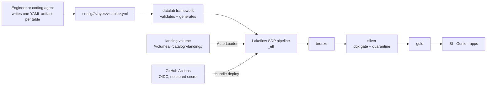

# Adopter repo file templates

Ready-to-paste contents for a fresh single-domain adopter repo at the repo
ROOT. Replace every placeholder before writing:

- `<catalog>` — the **base** Unity Catalog catalog / domain name (e.g. `acme`).
  The domain package is `<catalog>_etl`, the pipeline is `<catalog>_etl`. BASE
  name only — **no `_dev`/`_stage`/`_prod` suffix**: the bundle appends the
  environment per target (`acme` → `acme` / `acme_stage` / `acme_prod`), so a
  suffixed name yields `config/<catalog>_prod/` and a doubled `..._prod_prod`
  catalog. (`docs/NAMING.md`.)
- `<dev-catalog>` / `<stage-catalog>` / `<prod-catalog>` — the per-target
  catalogs; default `<catalog>`, `<catalog>_stage`, `<catalog>_prod`.
- `<customer>` / `<description>` — the customer's display name and a one-line
  description of the data product (default: derived from `<catalog>`).
- `<owner>` / `<customer-repo>` — the new repo's GitHub owner / name.
- `<host>` — the customer's (dev) Databricks workspace URL; `<stage-host>` /
  `<prod-host>` — the stage / prod workspaces (default: the same `<host>`).
- `<warehouse-id>` — a SQL warehouse id in the customer's workspace (UC bootstrap
  + the MCP grounding config).
- `<agents>` / `<components>` — the chosen coding agents and optional components
  (comma lists, or `none`); `<template-url>` —
  `https://github.com/dediggibyte/datalab/blob/main`.
- `<sync-exclude-entries>` / `<ignore-entries>` — the dev-only paths this repo
  HAS, one per line (see the `databricks.yml` and `.databricksignore` notes).
- `<cli-profile>` — the `databricks auth login` profile for the read-only MCP
  grounding (default `<catalog>_dev`).
- `<deploy-sp-app-id>` — the CI/CD deploy service principal application id.
- `<reader-group>` / `<engineer-group>` / `<admin-group>` — workspace groups.
- `<framework-tag>` — the pinned `datalab` framework release tag (`vX.Y.Z`).
- `<framework-version>` — the same release **without** the leading `v` — it is
  the wheel FILENAME (`datalab-<framework-version>-py3-none-any.whl`), which is
  why only a `vX.Y.Z` tag is accepted.

These mirror `projects/customer_sales/` but with ROOT-relative paths and a
single root `pyproject.toml`. Field reference: the framework `docs/FRAMEWORK.md`.

> **The engine is the source of truth.** `scripts/scaffold_adopter.py` writes
> every file below automatically — both `make configure-adopter` (convert a
> template clone in place) and `make new-adopter` (fresh sibling repo) call it.
> This doc is the human-readable record + the manual fallback, and
> `make check-templates-doc` (CI + pre-commit) fails if any code block below
> stops matching the engine's template. When they disagree, change the doc.

> **Optional pieces.** Sections fenced `<!-- adopter-if:<feature> start/end -->`
> (the README below, and the template's Makefile, CI, AGENTS.md, docs and guard
> scripts) are kept only when the new repo chose that coding agent or component
> — `docs`, `design`, `schemas`, `local-dev`, `githooks`, `pr-template`,
> `dependabot`, `framework-bot`, `mcp`, or `agent-<name>` / `any-agent` /
> `hooked-agent`; `!x` negates, `a|b` / `a&b` combine. By hand: keep the
> sections whose feature you chose, delete the rest, and delete the marker
> lines themselves. Which FILES each choice owns: [Optional pieces — which
> files each choice owns](#optional-pieces--which-files-each-choice-owns).

---

## Minimal domain

### `config/<catalog>/domain.yml`

```yaml
# yaml-language-server: $schema=../../schemas/domain_config.schema.json
#
# Domain settings — environment-agnostic: catalog/schema values are pipeline-conf
# KEYS resolved per target (dev/stage/prod) through bundle variables. Never put a
# literal catalog name here.
schema_version: 1
domain: <catalog>
imports: [] # python modules registering @transform fns + custom checks
catalog_conf: datalab.catalog
layers:
  bronze:
    schema_conf: datalab.bronze_schema
    table_properties:
      datalab.layer: bronze
  silver:
    schema_conf: datalab.silver_schema
    table_properties:
      datalab.layer: silver
  gold:
    schema_conf: datalab.gold_schema
    table_properties:
      datalab.layer: gold
```

### `config/<catalog>/bronze/events_raw.yml`

One Auto Loader bronze table to prove the toolchain. Add silver/gold later with
the `author-ldp-artifact` skill — it creates each layer folder along with the
first table in it. **Do NOT pre-create empty `config/<catalog>/silver/` /
`gold/` folders:** the framework's config validator rejects an empty layer dir,
so `make validate-configs` fails on the very first run.

```yaml
# yaml-language-server: $schema=../../../schemas/table_config.schema.json
#
# Starter table: bronze.events_raw — raw incremental ingest (Auto Loader).
# Add silver/gold with the author-ldp-artifact skill.
schema_version: 1
name: events_raw
comment: Raw events ingested incrementally from the landing volume (Auto Loader).
source:
  kind: cloud_files
  path_conf: datalab.landing_path
  format: json
  options:
    cloudFiles.inferColumnTypes: "true" # quote YAML-1.1 ambiguous scalars
    cloudFiles.schemaEvolutionMode: addNewColumns
  add_lineage: true # framework adds _ingest_ts + _source_file
target:
  kind: streaming_table
```

### `src/<catalog>_etl/__init__.py`

```python
"""<catalog>_etl — the <catalog> domain's adoption of the datalab framework.

Domain-owned code only: transforms/ (pure functions), checks/ (custom dqx
checks), transformations/pipeline.py (the LDP entrypoint). The reusable
framework lives in ``datalab`` and is never edited from here.
"""
```

### `src/<catalog>_etl/transformations/pipeline.py`

Copy verbatim — this 3-line entrypoint never grows; tables are added in YAML.

```python
"""<catalog>_etl pipeline entrypoint — the entire domain is config-driven.

Datasets, transforms and dqx quality rules live in the domain's config dir (the
bundle supplies the deployed path as ``datalab.config_dir``); the framework
validates them and registers every LDP dataset. Add a table by editing YAML —
see docs/GETTING_STARTED.md.
"""

from pyspark.sql import SparkSession

from datalab.config import pipeline_conf
from datalab.framework import generate

# The active session is the SDP-runtime session on Databricks and the session the
# OSS `spark-pipelines` CLI creates locally — one entrypoint, every profile.
spark = SparkSession.getActiveSession() or SparkSession.builder.getOrCreate()
generate(spark, pipeline_conf(spark, "datalab.config_dir"))
```

### `src/<catalog>_etl/transforms/__init__.py`

Package marker (add `@transform` functions here as you need them):

```python
"""Pure @transform functions for the <catalog> domain (registered via decorators)."""
```

### `src/<catalog>_etl/checks/__init__.py`

```python
"""Custom @check_function dqx checks for the <catalog> domain."""
```

### `tests/conftest.py`

```python
"""Local SparkSession fixture for the <catalog> domain tests."""

import pytest
from pyspark.sql import SparkSession


@pytest.fixture(scope="session")
def spark():
    session = (
        SparkSession.builder.master("local[2]")
        .appName("<catalog>-tests")
        .config("spark.sql.shuffle.partitions", "2")
        .config("spark.ui.enabled", "false")
        .getOrCreate()
    )
    yield session
    session.stop()
```

### `tests/test_smoke.py`

Not optional: `pytest` exits **5 ("no tests collected")** on an empty suite, so a
repo with only `conftest.py` fails its own documented `make test` gate before you
have written anything.

```python
"""Smoke test: the domain package imports (keeps `make test` non-empty)."""

import importlib


def test_domain_package_imports():
    assert importlib.import_module("<catalog>_etl") is not None
```

---

## Bundle resources (root-level)

### `resources/<catalog>_etl.pipeline.yml`

Paths are relative to THIS file (which now sits at `resources/`, beside `src/`
and `dist/`): `../src/...` and `../dist/...` (NOT `../../../` as in the
reference repo, where resources sit under `projects/<catalog>/resources/`).

`environment_version` ships **commented out** — see the comment in the block
(and `docs/ADOPTING.md` "First-deploy traps"). Uncommenting it on a brand-new
pipeline trips a Databricks fingerprint gate that leaves the pipeline unable to
run until the setting is removed again.

```yaml
# Lakeflow Spark Declarative Pipeline for the <catalog> domain (bronze→silver→gold).
# Paths below are relative to THIS file (resources/ sits beside src/ and dist/).
resources:
  pipelines:
    <catalog>_etl:
      name: <catalog>_etl
      catalog: ${var.catalog}
      schema: ${var.silver_schema}
      serverless: true
      channel: CURRENT
      root_path: "../src/<catalog>_etl"

      libraries:
        - glob:
            include: ../src/<catalog>_etl/transformations/**

      environment:
        # Pins the Python runtime + preinstalled library set independently of DBR
        # upgrades. COMMENTED OUT for the FIRST deploy: Databricks gates enabling
        # environment_version on a new pipeline behind a fingerprint check that
        # rejects it (NO_PREVIOUS_FINGERPRINT, then FINGERPRINT_MISMATCH) and
        # leaves the pipeline unable to run until the setting is removed. Every
        # documented remedy was tried against a real pipeline (2026-08),
        # including a compatibility scan that reported ZERO issues while the gate
        # still refused. Uncomment once the pipeline has a stable update history
        # — see docs/ADOPTING.md "environment_version".
        # environment_version: "4"
        dependencies:
          # datalab FRAMEWORK wheel from THIS catalog's artifacts.wheels Volume
          # (make publish-wheel; bump var.datalab_version to roll it). Serverless
          # does NOT honor an --editable install of synced workspace files.
          - ${var.datalab_wheel}
          # This domain's wheel — built by the bundle's <catalog>_etl_wheel artifact.
          - ../dist/<catalog>_etl-*.whl

      configuration:
        datalab.env: ${bundle.target}
        datalab.catalog: ${var.catalog}
        datalab.bronze_schema: ${var.bronze_schema}
        datalab.silver_schema: ${var.silver_schema}
        datalab.gold_schema: ${var.gold_schema}
        datalab.landing_path: ${var.landing_path}
        datalab.config_dir: ${workspace.file_path}/config/<catalog>

      permissions: ${var.pipeline_permissions}
```

### `resources/<catalog>_etl.job.yml`

```yaml
# Scheduled refresh of the <catalog>_etl pipeline (paused in dev).
resources:
  jobs:
    <catalog>_etl_refresh:
      name: <catalog>_etl_refresh
      trigger:
        periodic:
          interval: 1
          unit: DAYS
      tasks:
        - task_key: refresh_<catalog>_etl
          pipeline_task:
            pipeline_id: ${resources.pipelines.<catalog>_etl.id}
      queue:
        enabled: true
      permissions: ${var.job_permissions}
```

### `sample_data/landing/<catalog>/events/events.json`

Starter sample landing data — `make run-local` reads it (the Makefile's
`LOCAL_LANDING` points here), and uploading it to the landing volume proves the
first dev refresh (`docs/NEW_ADOPTER.md` step 9):

```json
{"event_id": "e-0001", "event_type": "signup", "user_id": "u-001", "ts": "2026-01-15T09:30:00Z"}
{"event_id": "e-0002", "event_type": "login", "user_id": "u-001", "ts": "2026-01-16T08:02:11Z"}
{"event_id": "e-0003", "event_type": "purchase", "user_id": "u-002", "ts": "2026-01-16T12:44:03Z"}
```

---

## Repo-level files

### `databricks.yml`

```yaml
# Declarative Automation Bundle for the <catalog> datalab adopter repo.
# Thin manifest: bundle name + includes. Everything else is deep-merged in.
bundle:
  name: <catalog>

# One wheel: this domain's package (uv build at the root). The framework wheel is
# delivered separately from the UC Volume (var.datalab_wheel). uv must be on PATH
# for `bundle deploy`.
artifacts:
  <catalog>_etl_wheel:
    type: whl
    build: uv build --wheel
    path: .

include:
  - variables/*.yml
  - targets/*.yml
  - rbac.yml
  - resources/*.yml

# Dev-only surfaces kept OUT of the deployed workspace files (DAB ignores
# .databricksignore; sync.exclude is the bundle-effective mechanism). Keep this
# aligned with .databricksignore — `make check-sync-lists` (CI) enforces it.
sync:
  exclude:
<sync-exclude-entries>
```

`<sync-exclude-entries>` lists, as `    - <path>` lines in this order, only the
dev-only paths the repo HAS: `tests`, then `docs` / `design` / `sample_data`
(when those components were chosen), `.github`, then `.claude` (claude or
codex), `.cursor` (claude, codex or cursor), `.codex`, `.agents` (any agent),
`.githooks`, `.mcp.json` (claude + mcp), and always `Makefile`, `uv.lock`,
`.markdownlint.json`, `.datalab-adopter.json`. The engine writes this list and
`.databricksignore` from ONE function (`sync_excludes`), so the two can never
disagree — `make check-sync-lists` (CI) fails if hand-edits make them diverge.

### `pyproject.toml`

Single buildable package at the root (NO uv workspace — that is only for the
multi-domain reference repo).

```toml
# <catalog> — single-domain adopter repo for the datalab framework.
#
# The reusable FRAMEWORK lives in dediggibyte/datalab-framework and is consumed:
#   * local dev / CI         → the `datalab` git dependency (pinned to a tag);
#   * Databricks serverless  → the versioned wheel from this catalog's
#     artifacts.wheels UC Volume (var.datalab_wheel), listed in each resource.
# KEEP IN LOCKSTEP: the `datalab` git tag below and var.datalab_version.

[build-system]
requires      = ["hatchling>=1.31.0"]
build-backend = "hatchling.build"

[project]
name            = "<catalog>_etl"
version         = "0.1.0"
description     = "<catalog> medallion (bronze→silver→gold) — datalab adopter domain."
requires-python = ">=3.12,<3.14"
dependencies    = []

[tool.hatch.build.targets.wheel]
packages = ["src/<catalog>_etl"]

[dependency-groups]
dev = [
    "pytest>=8.4",
    "ruff>=0.14",
    # Local Spark for tests + the OSS local-run profile. Never add
    # databricks-connect here (conflicts with pyspark; use `make validate-connect`).
    # Capped: the OSS SDP subset moves between minors (4.2.0 added an abstract
    # method to GraphElementRegistry and an SCD1-only create_auto_cdc_flow).
    # Needs datalab >= 0.8.2 for 4.2. Raise deliberately, after running tests.
    "pyspark[pipelines]>=4.1.0,<4.3",
    "pandas>=2.0",
    # The framework, pinned to a release tag (source mapped to git below). Keep the
    # tag in lockstep with var.datalab_version (the serverless UC-Volume wheel).
    "datalab",
]

[tool.pytest.ini_options]
testpaths = ["tests"]
addopts   = "-ra --tb=short"

[tool.ruff]
line-length    = 100
target-version = "py312"
# adopter-if:design start
# Vendored verbatim from the drawio-architecture-designer skill (the diagram
# kit scripts/design_diagram.py builds on) - kept byte-close to its upstream.
extend-exclude = ["scripts/drawio_kit"]
# adopter-if:design end

[tool.ruff.lint]
select = ["E", "F", "I", "W", "UP", "B"]
ignore = ["E501"]

[tool.ruff.lint.isort]
known-first-party = ["datalab", "<catalog>_etl"]

[tool.ruff.lint.per-file-ignores]
# `spark` is injected by the SDP runtime in the pipeline entrypoint; notebooks
# additionally get ambient dbutils/display (F821) + cell imports (E402).
"src/*/transformations/**" = ["F821"]
"notebooks/**" = ["F821", "E402"]

[tool.uv]
managed = true

[tool.uv.sources]
datalab = { git = "https://github.com/dediggibyte/datalab-framework.git", tag = "<framework-tag>" }
```

### `variables/medallion.yml`

```yaml
# Bundle variable declarations + defaults for the <catalog> medallion.
# Per-target VALUES live in targets/<env>.yml; access control in rbac.yml.
variables:
  catalog:
    description: Unity Catalog catalog that holds the medallion schemas.
    default: <catalog>
  bronze_schema:
    description: Schema for raw/ingested data.
    default: bronze
  silver_schema:
    description: Schema for cleaned, validated data.
    default: silver
  gold_schema:
    description: Schema for business-level aggregates.
    default: gold
  landing_path:
    description: UC volume path where raw JSON files land (Auto Loader source).
    default: /Volumes/${var.catalog}/landing/<catalog>/events/
  # --- framework wheel distribution (lockstep with the datalab git tag) -------
  datalab_version:
    description: Version of the datalab framework wheel installed from this catalog's artifacts.wheels volume.
    default: "<framework-version>"
  datalab_wheel:
    description: UC Volume path of the framework wheel in this catalog (var.catalog).
    default: /Volumes/${var.catalog}/artifacts/wheels/datalab-${var.datalab_version}-py3-none-any.whl
```

The `landing/<catalog>/` segment is a CONTRACT: `scripts/domains.py`'s
`edge_volume` must name the same volume, or `make bootstrap-uc` creates a volume
the pipeline never reads and the first `make run` fails.

### `targets/dev.yml`

```yaml
# dev target — development copies: resources get a '[dev <user>]' prefix and
# schedules/triggers are paused automatically.
targets:
  dev:
    mode: development
    default: true
    workspace:
      host: <host>
    variables:
      catalog: <dev-catalog>
```

### `targets/stage.yml`

```yaml
# stage target — production mode, explicit root_path. Deployed by CI on a
# vX.Y.Z-rcN tag once the `stage` GitHub Environment carries its secrets.
targets:
  stage:
    mode: production
    workspace:
      host: <stage-host>
      root_path: /Workspace/Bundles/${bundle.name}/${bundle.target}
    variables:
      catalog: <stage-catalog>
```

### `targets/prod.yml`

```yaml
# prod target — production mode, explicit root_path. Deployed by CI on a vX.Y.Z
# tag once the `prod` GitHub Environment carries its secrets.
targets:
  prod:
    mode: production
    workspace:
      host: <prod-host>
      root_path: /Workspace/Bundles/${bundle.name}/${bundle.target}
    variables:
      catalog: <prod-catalog>
```

All three targets are always written — a customer without a stage (or prod)
workspace yet simply leaves that GitHub Environment without Databricks secrets,
and CI/CD skips it gracefully until it is wired. The configurator's form asks
whether stage/prod live in other workspaces (`--host-stage` / `--host-prod`)
and lets you rename the per-target catalogs (`--catalog-{dev,stage,prod}`).

### `README.md`

The `adopter-if` sections below keep the README true for every selection — no
`make enable-githooks` without the git hooks, template-repo links instead of
`docs/` links without the docs, a hand-authoring pointer instead of the skill
without an agent.

````markdown
# <catalog>-datalab

**<customer>** — <description>

Single-domain [datalab](https://github.com/dediggibyte/datalab-framework) adopter
repo for <customer>, generated from the datalab template. Every target table
is ONE YAML artifact, generated into Lakeflow Spark Declarative Pipelines,
quality-checked with dqx, and deployed as a Declarative Automation Bundle.

<!-- adopter-if:docs start -->
> Document of record for agents + humans: **[AGENTS.md](AGENTS.md)**. First-deploy
> checklist: **[docs/NEW_ADOPTER.md](docs/NEW_ADOPTER.md)**. Wiring to the
> framework: **[docs/ADOPTING.md](docs/ADOPTING.md)**. Author your first table:
> **[docs/GETTING_STARTED.md](docs/GETTING_STARTED.md)**.
<!-- adopter-if:docs end -->
<!-- adopter-if:!docs start -->
> Document of record for agents + humans: **[AGENTS.md](AGENTS.md)**. This repo
> was generated without the `docs/` guides; the first-deploy checklist, the
> framework wiring reference and the authoring walkthrough live in the datalab
> template repo: [NEW_ADOPTER.md](<template-url>/docs/NEW_ADOPTER.md) ·
> [ADOPTING.md](<template-url>/docs/ADOPTING.md) ·
> [GETTING_STARTED.md](<template-url>/docs/GETTING_STARTED.md).
<!-- adopter-if:!docs end -->
<!-- adopter-if:design start -->
> Architecture and the generated pipeline inventory for <customer>:
> **[design/OVERVIEW.md](design/OVERVIEW.md)**.
<!-- adopter-if:design end -->

## Quick start

```bash
make lock install                # resolve the framework git dep into .venv
make validate-configs lint test  # pydantic + dqx · ruff · pytest (local Spark)
make validate                    # databricks bundle validate -t dev
```
<!-- adopter-if:githooks start -->

Once per clone, turn on the branch-first / protected-files pre-commit guard:
`make enable-githooks`.
<!-- adopter-if:githooks end -->

## First deploy (one-time setup per target)

<!-- adopter-if:docs start -->
The full ordered checklist — prerequisites, GitHub/OIDC wiring, and the
account-level persona groups that must exist BEFORE bootstrap — is
**[docs/NEW_ADOPTER.md](docs/NEW_ADOPTER.md)** (start at step 3: this repo is
already generated).
<!-- adopter-if:docs end -->
<!-- adopter-if:!docs start -->
The full ordered checklist — prerequisites, GitHub/OIDC wiring, and the
account-level persona groups that must exist BEFORE bootstrap — is the datalab
template repo's [docs/NEW_ADOPTER.md](<template-url>/docs/NEW_ADOPTER.md)
(start at step 3: this repo is already generated).
<!-- adopter-if:!docs end -->
The commands, once those prerequisites stand (`PROFILE=` pins the workspace —
without it the SDK uses your DEFAULT CLI profile, which may point somewhere
else):

```bash
databricks auth login --host <host> --profile <cli-profile>
make bootstrap-uc TARGET=dev WAREHOUSE_ID=<warehouse-id> PROFILE=<cli-profile>
make publish-wheel TARGET=dev APPLY=1 PROFILE=<cli-profile>
git add -A && git commit -m "configure <catalog> adopter" && git push  # CI needs the regenerated uv.lock
make deploy
```

<!-- adopter-if:local-dev start -->
Seed the landing volume with the starter sample, then refresh the pipeline:

```bash
databricks fs cp sample_data/landing/<catalog>/events/events.json \
    dbfs:/Volumes/<dev-catalog>/landing/<catalog>/events/ --profile <cli-profile>
make run
```
<!-- adopter-if:local-dev end -->
<!-- adopter-if:!local-dev start -->
Drop a JSON file into `/Volumes/<dev-catalog>/landing/<catalog>/events/`,
then refresh the pipeline with `make run`.
<!-- adopter-if:!local-dev end -->

## Add tables

<!-- adopter-if:any-agent start -->
Use the `author-ldp-artifact` agent skill: one `config/<catalog>/<layer>/<table>.yml`
artifact per table, pure `@transform` functions in `src/<catalog>_etl/transforms/`,
registered in `config/<catalog>/domain.yml` `imports:`.
<!-- adopter-if:any-agent end -->
<!-- adopter-if:!any-agent start -->
Author one `config/<catalog>/<layer>/<table>.yml` artifact per table, pure
`@transform` functions in `src/<catalog>_etl/transforms/`, registered in
`config/<catalog>/domain.yml` `imports:`. Field reference: the framework's
[FRAMEWORK.md](https://github.com/dediggibyte/datalab-framework/blob/<framework-tag>/docs/FRAMEWORK.md);
the datalab template repo's
[author-ldp-artifact skill](<template-url>/.agents/skills/author-ldp-artifact/SKILL.md)
doubles as a human guide (plain-language rule → dqx check mapping).
<!-- adopter-if:!any-agent end -->
<!-- adopter-if:design start -->

After adding or changing tables, jobs or pipelines, run `make design`: it
re-renders the pipeline inventory in `design/PIPELINES.md` and regenerates the
draw.io diagrams from the estate (CI's `make check-design` fails while either is
stale or a diagram was hand-edited). Never edit a `.drawio` file by hand.
<!-- adopter-if:design end -->

## How this repo was generated

From the datalab template with — coding agents: **<agents>**; components:
**<components>**. Every answer is recorded in `.datalab-adopter.json`; to
regenerate with a newer template (e.g. to diff in its improvements), run
`make new-adopter ANSWERS=<path-to>/.datalab-adopter.json OUT=<dir>` from a
clone of the datalab template repo.
````

### `CHANGELOG.md`

```markdown
# Changelog

All notable changes to this repo are documented here, in the
[Keep a Changelog](https://keepachangelog.com/en/1.1.0/) format with
[Semantic Versioning](https://semver.org/spec/v2.0.0.html).

**Releases are cut by the deploy.** Record every change as a bullet under
`## [Unreleased]` (start it `**BREAKING:**` when it breaks something). After
each successful deploy of `main` to dev, CI moves those entries into
`## [X.Y.Z] — YYYY-MM-DD`, sets `pyproject.toml` `[project].version` (and
`uv.lock`) to `X.Y.Z` and pushes a `chore(release): vX.Y.Z` commit — the commit
stage and prod promote (tag `vX.Y.Z-rcN` / `vX.Y.Z`). Never cut a version by
hand; `make release-changelog` previews the next cut.

## [Unreleased]

### Added
- Initial <catalog> adopter repo for <customer>, generated from the datalab
  template (one minimal bronze table to extend). Coding agents: <agents>;
  components: <components>.
```

### `.databricksignore`

Written from the same entry list as `databricks.yml`'s `sync.exclude` (above);
`<ignore-entries>` is that list one per line, directories with a trailing `/`.

```gitignore
# Exclusions for `databricks sync` and the Databricks IDE extension.
#
# IMPORTANT: `databricks bundle deploy` does NOT read this file — it honors
# .gitignore plus the `sync.exclude:` block in databricks.yml. Keep this list
# ALIGNED with that block so the sync command and the bundle deploy exclude the
# same dev-only surfaces (`make check-sync-lists` enforces it).
#
# The deploy MUST ship pyproject.toml + src/** + config/** + resources/** — the
# domain wheel is built by the databricks.yml `artifacts:`, and the framework
# wheel is installed from this catalog's artifacts.wheels UC Volume (AGENTS.md
# "Wheel delivery").

<ignore-entries>
```

### `rbac.yml`

Not rewritten — keep the reference `rbac.yml` structure verbatim (the string-var
+ complex-var pivot). Only change the group-name defaults and per-target
overrides:

- `reader_group.default` → `<reader-group>`
- `engineer_group.default` → `<engineer-group>`
- `admin_group.default` → `<admin-group>`
- in `targets.stage.variables` / `targets.prod.variables`, set the stage/prod
  group names (and prod read levels) for the customer.

The groups must be **account-level** (`databricks account groups create` +
`databricks account workspace-assignment update`) before `make bootstrap-uc`.
Workspace-local groups (`databricks groups create`) are invisible to Unity
Catalog and every GRANT fails `PRINCIPAL_DOES_NOT_EXIST` — `docs/NEW_ADOPTER.md`
step 5.

---

## Design package (only with the `design` component)

The template's own `design/` describes ITS reference domains, so it is never
copied; the adopter gets a package generated for the customer:

- `design/OVERVIEW.md` — the narrative (below).
- `design/estate.yml` - the hand-written overlay (below): source systems,
  consumers and edge-job reads/writes that no bundle YAML states. Starts empty.
- `design/02_implementation_end_to_end.drawio` and
  `design/01_design_config_driven_medallion.drawio` - **generated**, never
  hand-written: `scripts/design_diagram.py` builds the estate map (overview,
  one lineage page per domain, delivery) from the finished repo, and
  `scripts/design_spec.py` the conceptual spec, both through the vendored
  drawio-architecture-designer kit (`scripts/drawio_kit/`). The engine runs the
  generator LAST (`write_design_diagrams`), after every other file is final; the
  spec's worked-example lines are repointed at `<catalog>` in the adopter's own
  `scripts/design_spec.py` (`DESIGN_SPEC_EDITS`), so its `make design`
  reproduces the same files. By hand: copy those scripts and run `make design`.
- `design/PIPELINES.md` - **rendered** by `scripts/design_inventory.py` from
  the `config/` artifacts. Never hand-write it - run `make design` after
  `make install`; CI's `make check-design` fails while it or a diagram is stale,
  hand-edited, or fails the layout audit.
- `scripts/design_inventory.py`, `scripts/design_diagram.py`,
  `scripts/design_spec.py`, `scripts/drawio_kit/`, `scripts/export_design.py`,
  the `design` / `check-design` / `design-preview` make targets, the CI step,
  and (with an agent) the `maintain-design-diagram` + `drawio-architecture-designer`
  skills and the `.cursor/hooks/design_drawio_guard.py` hook ship with it.

### `design/OVERVIEW.md`

````markdown
# <customer> — `<catalog>` lakehouse on Databricks

<description>

> This is the living design package for this repo. The estate map
> [`02_implementation_end_to_end.drawio`](02_implementation_end_to_end.drawio)
> (an overview, one lineage page per domain, and the delivery path) and the
> framework's conceptual design
> [`01_design_config_driven_medallion.drawio`](01_design_config_driven_medallion.drawio)
> are **generated** by `make design` from the repo itself - never edit their XML.
> **[PIPELINES.md](PIPELINES.md) is generated from `config/`** - every table,
> its source, target kind and quality gate. CI fails while any of them is stale.

## At a glance

| | |
|---|---|
| **Customer** | <customer> |
| **Domain / base catalog** | `<catalog>` — config in `config/<catalog>/`, code in `src/<catalog>_etl/` |
| **Pipeline** | `<catalog>_etl` — Lakeflow Spark Declarative Pipeline, serverless |
| **Refresh** | `<catalog>_etl_refresh` — daily (paused in dev) |
| **Framework** | datalab `<framework-tag>` (git dependency + UC-Volume wheel) |
| **Pipeline inventory** | [PIPELINES.md](PIPELINES.md) (generated — `make design`) |

## Architecture



The medallion starts with one bronze table; [PIPELINES.md](PIPELINES.md) holds
the live table-by-table lineage.

## Environments and promotion

| Target | Workspace | Catalog | Mode | Deployed by |
|---|---|---|---|---|
| dev | `<host>` | `<dev-catalog>` | development | every push to `main` |
| stage | `<stage-host>` | `<stage-catalog>` | production | a `vX.Y.Z-rcN` tag |
| prod | `<prod-host>` | `<prod-catalog>` | production | a `vX.Y.Z` tag |

Promotion never edits a config file: catalogs, schemas and paths are bundle
variables resolved per target.

## Keeping this package current

- **Tables** — after adding or changing a `config/<catalog>/…` artifact, run
  `make design`; it re-renders [PIPELINES.md](PIPELINES.md). CI runs
  `make check-design` and fails while the inventory is stale.
- **Architecture** - new tables, pipelines and jobs appear on the diagrams by
  themselves on the next `make design`. A source system, consumer or edge-job
  read/write that no bundle YAML states goes in [`estate.yml`](estate.yml); then
  `make design`, look at `make design-preview`, and refresh this overview's
  narrative.
````

### `design/estate.yml`

```yaml
# design/estate.yml - what the diagrams need that no bundle YAML states.
#
# design/*.drawio are GENERATED by scripts/design_diagram.py from config/,
# resources/*.yml, targets/, .github/workflows/ and this file (`make design`;
# `make check-design` fails CI when they drift). Declare only relationships the
# code cannot express. Tables are <domain>.<layer>.<table>; an unknown one
# fails the generator. See the maintain-design-diagram skill.
#
# sources:   [{name, detail?, logo?, feeds: [<catalog>.bronze.<table>]}]
# consumers: [{name, detail?, logo?, reads: [<catalog>.gold.<table>]}]
# jobs:      {<job resource key>: {reads: [...], writes: <string>}}
```

### `.gitattributes`

Only with `design` (the template's own `.gitattributes` holds nothing but design
rules, so without the component the adopter has none):

```gitattributes
# GitHub Linguist: design/ is documentation (draw.io sources, their PNG exports,
# the overview and the generated pipeline inventory), not source — keep it out
# of the repository's language statistics.
design/**              linguist-documentation
# Rendered by `make design` (scripts/design_inventory.py) — collapse it in diffs.
design/PIPELINES.md    linguist-generated
# Generated by `make design` (scripts/design_diagram.py) - collapse them in diffs.
design/*.drawio        linguist-generated
```

---

## Files to EDIT in place (not full rewrites)

### `Makefile`

- `LINT_PATHS := scripts src`
- `PIPELINE ?= customer_sales_etl` → `PIPELINE ?= <catalog>_etl` (the `run:`
  recipe reads `$(PIPELINE)`)
- `LOCAL_DOMAIN_CONFIG ?= config/<catalog>`
- `LOCAL_TRANSFORMS ?= src/<catalog>_etl/transformations`
- `LOCAL_LANDING ?= $(CURDIR)/sample_data/landing/<catalog>/events`
- in `spec-local`, the `--conf datalab.sales_landing_path=...` → `--conf datalab.landing_path=file://$(LOCAL_LANDING)`
- `CONNECT_CONFIG ?= config/<catalog>` and `CONNECT_DOMAIN ?= .`
- `CONFIG_DIRS := config` (drop the `projects/*/config` wildcard + its comment),
  and the `lint:` help comment → "Ruff lint over scripts/ and src/".
- The `run:` help text and the comment above `PIPELINE` name `<catalog>_etl`,
  not the template's `customer_sales_etl` / second domain.
- Resolve the `# adopter-if:<feature> start/end` sections: each optional section
  (schemas, the agent-skill targets, design, local dev, git hooks, and the
  template-only scaffold targets) declares its own `.PHONY` inside its fence, so
  deleting a section you did not choose removes its declaration too. Keep the
  sections you chose and delete every marker line.

### `scripts/domains.py`

The domain registry — the ONE place listing the repo's domains. Per-target
catalogs and groups are RESOLVED from `variables/` + `targets/` + `rbac.yml`,
so this is the only registry edit. `edge_volume` NAMES the `landing`/`exports`
UC volume bootstrap creates — it MUST equal the volume segment of
`var.landing_path` (`/Volumes/${var.catalog}/landing/<catalog>/events/` above),
or the first `make run` fails on a volume that was never provisioned:

```python
DOMAINS: dict[str, dict] = {
    "<catalog>": {"catalog_var": "catalog", "edge_volume": "<catalog>"},
}
```

`scripts/bootstrap_uc.py` and `scripts/publish_wheel.py` need no
catalog/group/volume edits — they resolve through `domains.py` (the ONLY
bootstrap_uc.py change is the `DEPLOY_SP` constant, below).

### `scripts/bootstrap_uc.py`

```python
DEPLOY_SP = "<deploy-sp-app-id>"
```

### `.github/workflows/common-ci-steps.yml`

- Ruff step: `uv run ruff check scripts projects` → `uv run ruff check scripts src`.
- The config-validation loop `for d in config projects/*/config` already matches
  the root `config/` — leave it (or simplify to `config`).
- DELETE everything below the `# --- template-only below: stripped from generated
  adopters …` marker (the scaffold smoke-test job exercises the TEMPLATE layout
  and would fail in an adopter).
- Resolve the `# adopter-if:<feature>` steps (skills mirror, agent-config check,
  templates-doc check, schemas check, design check, local dry-run): keep a step
  only if the repo has what it checks.
- Keep the GitHub App token steps ("Mint a read-only token for datalab-framework"
  + the HTTPS `insteadOf` rewrite). The adopter repo must set the
  `DATALAB_FRAMEWORK_APP_CLIENT_ID` variable + `DATALAB_FRAMEWORK_APP_PRIVATE_KEY` secret
  (from the shared datalab-framework reader GitHub App) and have read access to the
  (private) framework repo, or `uv sync` fails in CI.

### `.github/workflows/common-cd-steps.yml` + `.github/actions/deploy-dab/action.yml`

Single-domain CD plumbing:

- `common-cd-steps.yml`: drop the `sales-catalog:` forward; rename the
  `sales-landing-path:`/`DATALAB_SALES_LANDING_PATH` forward to
  `landing-path:`/`DATALAB_LANDING_PATH`.
- `deploy-dab/action.yml`: drop the `sales-catalog`/`sales-landing-path` inputs
  in favour of one `landing-path` input; retitle the remaining `catalog` input
  for this domain; in the publish step use `--catalog-for "<catalog>=$IN_CATALOG"`;
  in the deploy step map `IN_LANDING_PATH` to `--var "landing_path=…"` and drop
  the `sales_catalog` var.

### `.github/CODEOWNERS`

Reduce to a commented placeholder. Left as-is it routes review at
`@dediggibyte/datalab-approvers`, a team that does not exist in the adopter's
org — GitHub then treats the whole file as invalid and the "Require review from
Code Owners" branch protection silently never applies.

### `.github/dependabot.yml`

Cross-org adopters: the `uv` ecosystem cannot resolve the PRIVATE framework git
dep (`git_dependencies_not_reachable`) without either a Dependabot
`registries:` git credential or an org-level Dependabot grant on the framework
repo. `docs/CICD.md` "Private framework dependency"; the scaffold leaves an
explanatory comment in place, not a fix.

### `docs/`

The `docs/` are reusable framework guidance — keep them, but they carry
template-specific identity that must be repointed:

- `docs/CICD.md` — federation subject `repo:dediggibyte/datalab:environment:<target>`
  → `repo:<owner>/<repo>:environment:<target>` (both occurrences), SP application
  id `437346a1-…` → `<deploy-sp-app-id>`, workspace host → the adopter's host.
  Otherwise a first-timer copying the federation-policy command from their OWN
  docs wires OIDC to the TEMPLATE's service principal.
- `docs/AGENT_MCP.md` — CLI profile `diggi_dev_aws` → `<cli-profile>`, warehouse
  id `c1cdbe2406e5cf04` → `<warehouse-id>`, workspace host → the adopter's host.
- `docs/NAMING.md` — the `sales_landing_path` / `sales_export_path` /
  `DATALAB_SALES_LANDING_PATH` names become `landing_path` / `export_path` /
  `DATALAB_LANDING_PATH`; `landing.sales` / `exports.sales` become
  `landing.<catalog>` / `exports.<catalog>`.
- `docs/GETTING_STARTED.md`, `docs/ADOPTING.md` — every `projects/…` example path
  must name the template repo explicitly (those folders are deleted here).
- The worked examples are re-cast in the CUSTOMER's catalog: `docs/NAMING.md`'s
  config-tree and environment tables (`<catalog>`, `<dev-catalog>` …),
  `docs/ARCHITECTURE.md`'s system / lanes / data-view diagrams and its
  environment table (per-target catalogs + workspaces), `docs/AGENT_MCP.md`'s
  example query, `docs/ADOPTING.md`'s wheel volume. The template-facing
  sections (`ADOPTING.md`'s quick start, `NEW_ADOPTER.md` steps 1–2,
  `AGENT_MCP.md`'s adopter setup) become short "this repo was generated" notes.
- Passages about a component the repo did not choose are fenced
  `<!-- adopter-if:<feature> -->` and dropped. Without the `docs` component the
  whole folder is left out and every surviving `docs/<X>.md` reference (in
  AGENTS.md, README, skills, workflow comments) is relinked to the template
  repo's copy — `docs/FRAMEWORK.md` to the framework repo's reference.

`make check-adopter-docs ADOPTER=<dir>` (template CI, every generated profile)
fails if any of this survives: template identity, or a reference to a path or
`make` target the repo does not have.

### `AGENTS.md`

The document of record — CLAUDE.md auto-loads it, so it must not describe the
template's `projects/` + `design/` + `omnigent/` layout the conversion deleted.
The engine (`patch_agents_md`) swaps every region fenced with
`<!-- template-only:<name> start/end -->` markers for adopter text (root-level
layout, `<catalog>_etl` architecture), re-points example file paths at "the
template repo's `projects/...`", rewrites the second domain's
`var.sales_datalab_wheel` / MCP-profile references, resolves the
`<!-- adopter-if:<feature> -->` passages, and rewrites the sentences that
ENUMERATE optional pieces (which harness configs wire the branch guard, which
guards hold the protected set, the schema regeneration, the bump bot) to name
only what the repo has. The codebase-layout block lists only the chosen
agents/components. Manual fallback: delete each fenced region, write the adopter
equivalent (layout + architecture for YOUR domain), and verify
`grep -n "projects/\|omnigent" AGENTS.md | grep -v "template repo"` comes back
empty.

### `.cursor/rules/project.mdc` and the agent skills

`project.mdc` and the `author-ldp-artifact` / `deploy-databricks-bundle` skills
cite `projects/customer_sales/…` paths and the second domain's
`sales_landing_path` variable. Repoint them at the adopter's root-level layout
(and re-run `make sync-skills` so the `.claude/skills` copy matches, or
`make check-skills` fails).

### `.mcp.json` and `.cursor/mcp.json` (the MCP grounding config)

Both ship pointing at the TEMPLATE's read-only-query workspace — repoint them at
the customer's, or the adopter's agents query the wrong workspace. Swap the CLI
profile `diggi_dev_aws` → `<cli-profile>` and warehouse id `c1cdbe2406e5cf04` →
`<warehouse-id>` in BOTH files. `.mcp.json` keeps its `${VAR:-default}` env
override; `.cursor/mcp.json` holds the literals. A placeholder `<warehouse-id>`
is fine for now (the MCP is opt-in/dev-time and `.mcp.json`'s env var overrides
it) — fill it before relying on the grounding (`docs/AGENT_MCP.md`).

```jsonc
// .mcp.json — the two args that carry the workspace identity
"--profile", "${DATABRICKS_CONFIG_PROFILE:-<cli-profile>}",
"--meta",    "warehouse_id=${DATABRICKS_SQL_WAREHOUSE_ID:-<warehouse-id>}"
// .cursor/mcp.json — same two values, as literals
"--profile", "<cli-profile>",
"--meta",    "warehouse_id=<warehouse-id>"
```

### `.claude/settings.json`, `.codex/hooks.json`, `.cursor/hooks.json`

Kept only for their agent. The Claude settings' `permissions.allow` is
regenerated to hold exactly the READ-ONLY `make` targets this repo defines
(`help`, `lint`, `test`, `validate-configs`, `dry-run-local`, `check-*`) — never
a write grant, never a grant for a target the repo lacks. Without the
`pr-template` component, every hook entry running `pr_template_guard.py` is
removed from all three configs (the guard would otherwise demand a template the
repo does not have). `make check-agent-settings` verifies every hook script
still exists.

---

## Optional pieces — which files each choice owns

| Choice | Files it brings (gone when not chosen) |
|---|---|
| any agent | `.agents/skills/` (minus `bootstrap-adopter-repo` - template-only; `query-databricks` needs `mcp`; `maintain-design-diagram` and `drawio-architecture-designer` need `design`) |
| `claude` | `CLAUDE.md`, `.claude/settings.json`, `.claude/skills/` (copy of `.agents/skills`), `scripts/sync_skills.py` |
| `claude` or `codex` | `.claude/hooks/protected_files_guard.py` |
| `claude`, `codex` or `cursor` | `.cursor/hooks/branch_guard.py` (+ `pr_template_guard.py` with `pr-template`), `scripts/check_agent_settings.py` |
| `codex` | `.codex/hooks.json` |
| `cursor` | `.cursor/hooks.json`, `.cursor/rules/` (+ `.cursor/mcp.json` with `mcp`) |
| `genie` | `scripts/publish_genie_skills.py` |
| `docs` | `docs/` (+ `docs/AGENT_MCP.md` with `mcp`; `docs/MIGRATION.md` never — template history) |
| `design` | `design/` (generated), `.gitattributes`, `scripts/export_design.py`, `scripts/design_inventory.py`, `scripts/design_diagram.py`, `scripts/design_spec.py`, `scripts/drawio_kit/`, and with a hooked agent `.cursor/hooks/design_drawio_guard.py` |
| `schemas` | `schemas/`, `scripts/sync_schemas.py` (and the `$schema` header in each config YAML) |
| `local-dev` | `sample_data/`, `scripts/validate_connect.py` |
| `githooks` | `.githooks/` |
| `pr-template` | `.github/pull_request_template.md`, `.github/workflows/pr-template-check.yml` |
| `dependabot` | `.github/dependabot.yml` |
| `framework-bot` | `.github/workflows/framework-bump.yml` |
| `mcp` (with claude / cursor) | `.mcp.json` (claude), `.cursor/mcp.json` (cursor), `docs/AGENT_MCP.md`, the `query-databricks` skill |
| never | `projects/`, `omnigent/`, `uv.lock` (regenerated by `make lock`), the template's `design/`, `scripts/scaffold_adopter.py`, `scripts/check_templates_doc.py`, `scripts/check_adopter_docs.py` |

The engine's `TOP_LEVEL` + `PATH_RULES` tables are the source of this list; a
new top-level file in the template that is not classified there fails the
scaffold.
