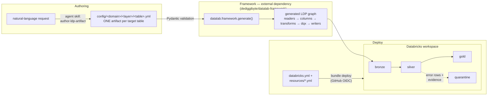
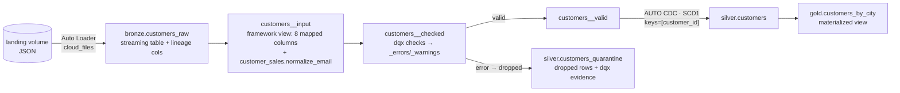

# datalab

[](https://www.python.org/downloads/)
[](https://docs.databricks.com/aws/en/dlt/)
[](https://databrickslabs.github.io/dqx/)
[](https://github.com/astral-sh/uv)
[](https://github.com/astral-sh/ruff)
[](https://github.com/dediggibyte/datalab/actions/workflows/ci-cd.yml)
[](docs/GETTING_STARTED.md)

**Reference domains + deploy bundle for the config-driven [datalab
framework](https://github.com/dediggibyte/datalab-framework).** The reusable
framework lives in its **own repo**; THIS repo is the worked adoption — every
target table is ONE YAML artifact, validated by Pydantic, generated into
**Lakeflow Spark Declarative Pipelines** (`pyspark.pipelines`), quality-checked
end to end with [databrickslabs/dqx](https://databrickslabs.github.io/dqx/), and
deployed to Databricks as a **Declarative Automation Bundle** with GitHub-OIDC
CI/CD. The framework is consumed as a **git dependency** (local/CI) and a
versioned **UC-Volume wheel** (serverless) this repo builds + publishes on deploy.

> AI coding agents and humans: the document of record is **[AGENTS.md](AGENTS.md)**.
> Read it before editing. New here? **[docs/ADOPTING.md](docs/ADOPTING.md)** wires
> your repo to the framework; **[docs/GETTING_STARTED.md](docs/GETTING_STARTED.md)**
> authors your first table.
>
> Standing up a repo for **another customer**? Follow the ordered checklist in
> **[docs/NEW_ADOPTER.md](docs/NEW_ADOPTER.md)** — generate from this **GitHub
> template repository**, then `make configure-adopter` (or let the
> `bootstrap-adopter-repo` skill drive it) converts the clone into a minimal,
> root-level single-domain adopter repo — carrying only the coding agents
> (claude / codex / cursor / genie) and optional components (docs, a design
> package generated for the customer, schemas, local-dev tooling, git hooks, …)
> you confirm in its short form. Reference for what the conversion does and
> what each choice ships: [docs/ADOPTING.md](docs/ADOPTING.md).

## Architecture at a glance



> Higher-fidelity architecture diagrams (draw.io) live in [`design/`](design/),
> GENERATED from the estate by `make design`: a multi-page design spec
> (`01_design_config_driven_medallion.drawio`) and an estate map
> (`02_implementation_end_to_end.drawio` - overview, one lineage page per domain,
> delivery). See
> [Editing the design diagrams](docs/ARCHITECTURE.md#editing-the-design-diagrams)
> for how to regenerate, preview and keep them in sync - never edit the XML.

Three invariants hold everywhere:

- **One artifact per table.** Columns (source→target names + types), dqx
  rules, transforms and target kind live in a single YAML file. No `dlt`,
  no hand-wired `dp` calls.
- **Rows are never silently dropped.** Every error-criticality rule
  auto-creates `<table>_quarantine` with `_errors` evidence structs.
- **No hardcoded catalogs — ever.** Every location is a pipeline-conf key
  resolved per environment through bundle variables; promoting
  dev → stage → prod never edits a config file.

## Documentation map

```mermaid
flowchart TD
    README["README.md<br/>(you are here)"] --> ADOPT["docs/ADOPTING.md<br/>wire your repo to the framework:<br/>git dep · UC-Volume wheel · bootstrap"]
    README --> GS["docs/GETTING_STARTED.md<br/>author your first table:<br/>empty folder → deployed pipeline"]
    README --> FWK["framework repo · docs/FRAMEWORK.md<br/>flowspec reference: artifact anatomy ·<br/>target kinds · dqx · capability matrix"]
    README --> NAM["docs/NAMING.md<br/>folder structure mirrors the UC namespace:<br/>catalog · schema · table"]
    README --> EX["projects/customer_sales/<br/>complete worked domain to copy"]
    README --> OVR["design/OVERVIEW.md<br/>customer-facing tour:<br/>driving medallion transformations"]
    README --> ARCH["docs/ARCHITECTURE.md<br/>system view · lanes · code layout · governance"]
    README --> CICD["docs/CICD.md<br/>workflows · OIDC setup · release flow"]
    README --> MIG["docs/MIGRATION.md<br/>legacy DLT → hand-written SDP → flowspec"]
    README --> AGENTS["AGENTS.md<br/>document of record: authoring rules, router, guards"]
```



| Doc | Read it when |
|---|---|
| [docs/NEW_ADOPTER.md](docs/NEW_ADOPTER.md) | you are standing up a repo for a NEW customer — the one ordered checklist: prerequisites, generate + convert, GitHub/OIDC wiring, bootstrap, first deploy |
| [docs/ADOPTING.md](docs/ADOPTING.md) | you need the reference behind that checklist: the two consumption paths (git dep + UC-Volume wheel), framework credentials, pinning + publishing, UC bootstrap, first-deploy traps |
| [docs/GETTING_STARTED.md](docs/GETTING_STARTED.md) | you are authoring your first table on the framework — empty folder → deployed pipeline |
| [framework repo: docs/FRAMEWORK.md](https://github.com/dediggibyte/datalab-framework/blob/v1.0.0/docs/FRAMEWORK.md) | you are adding a table or domain: artifact schema, generated graph, target kinds, data-quality semantics, the SDP capability matrix — the reusable framework's reference (separate repo) |
| [docs/NAMING.md](docs/NAMING.md) | you are naming anything: folder paths mirror the UC namespace (catalog → schema → table), package/resource naming rules |
| [projects/customer_sales/](projects/customer_sales/README.md) | you want a finished example to copy — complete worked domain, mirrors an adopter repo |
| [design/OVERVIEW.md](design/OVERVIEW.md) | you want the customer-facing tour — how datalab drives transformations across bronze → silver → gold, with the architecture diagrams (shareable standalone: `design/datalab-customer-overview.html`) |
| [docs/ARCHITECTURE.md](docs/ARCHITECTURE.md) | you need the system picture: CI/CD → workspace resources, the three authoring lanes, code organization, environments, RBAC/ABAC |
| [docs/CICD.md](docs/CICD.md) | you are wiring a target or debugging a deploy: workflows, federation policies, GitHub Environments, release flow |
| [docs/MIGRATION.md](docs/MIGRATION.md) | you knew the legacy/intermediate codebase and need the old → current concept map |
| [AGENTS.md](AGENTS.md) | always, before editing — routing rules, protected files, PR conventions |
| [omnigent/README.md](omnigent/README.md) | you want to run datalab's authoring agent on [Omnigent](https://github.com/omnigent-ai/omnigent) (Claude Code / Codex / Cursor / Pi) — opt-in dev-time pilot, grounded in `AGENTS.md` |
| [docs/AGENT_MCP.md](docs/AGENT_MCP.md) | you want the agent (Claude Code / Cursor) to query live Unity Catalog tables while authoring — opt-in dev-time Databricks MCP, read-only, grounded by the `query-databricks` skill |

## Repository map

| Surface | Where | What |
|---|---|---|
| Framework | [`dediggibyte/datalab-framework`](https://github.com/dediggibyte/datalab-framework) (separate repo) | the REUSABLE library — Pydantic models, LDP generator, dqx engine, devtools, param helpers. Consumed here as a git dependency (local/CI, pinned in `pyproject.toml`) + a versioned UC-Volume wheel (serverless) |
| Reference domains | `projects/customer_sales/` + `projects/sales/` | complete worked adoptions, each named after its base UC catalog and mirroring an adopter repo root — copy one to start your own domain. `customer_sales` is the full reference (all 3 lanes: pipeline + jobs + notebook); `sales` is pipeline-only (silver + gold over pre-existing `sales.bronze.*`) |
| Dataset configs | `projects/customer_sales/config/customer_sales/` (adopters: `config/<catalog>/`) | ONE artifact per target table: column mappings + types, dqx rules, target kind — path mirrors `<catalog>.<schema>.<table>` |
| Domain code | `projects/customer_sales/src/customer_sales_etl/` (adopters: `src/<catalog>_etl/`) | pure `@transform` functions, custom dqx checks, 3-line pipeline entrypoint |
| Edge lanes | `projects/customer_sales/src/jobs/customer_sales/` + `projects/customer_sales/notebooks/customer_sales/` | python-file lane (headless exports) + notebook lane (human-gated triage) |
| Deploy | `databricks.yml` + `projects/*/resources/` (adopters: `resources/`) | bundle variables, targets `dev`/`stage`/`prod`, pipeline + jobs |
| Tests | `projects/*/tests/` (per-domain) | unit tests on a local SparkSession — no workspace needed. Framework unit tests live in the `datalab-framework` repo |
| CI/CD | `.github/` | ruff + pytest + config validation + `bundle validate` on PRs; OIDC deploys on merge/tags |
| Agent harness | `.claude/`, `.cursor/`, `.codex/` + `.agents/skills/`, `.githooks/`, `.mcp.json` | rules + skills + PR-template/protected-file guards across three harnesses (`.codex` references the canonical guards; the 7 skills are authored once in `.agents/skills/` - read natively by Cursor + Codex - and copied to `.claude/skills/` via `make sync-skills`, and pushed to Databricks Genie via `make publish-genie-skills`), opt-in Databricks MCP config (read-only UC queries - [docs/AGENT_MCP.md](docs/AGENT_MCP.md)) |
| Docs | `docs/` | the child docs mapped above |
| Design | `design/` | customer-facing [`OVERVIEW.md`](design/OVERVIEW.md) + GENERATED draw.io diagrams (`01_*` spec, `02_*` estate map - `scripts/design_diagram.py` via the vendored drawio-architecture-designer kit), `images/` PNG exports and `PIPELINES.md` (`make design`; `make check-design` gates CI), the `estate.yml` overlay and a standalone share HTML; kept in sync via the `maintain-design-diagram` + `drawio-architecture-designer` skills ([how to edit](docs/ARCHITECTURE.md#editing-the-design-diagrams)) |

## Quick start

```bash
# prereqs: uv, Java 17+ (local Spark), Databricks CLI >= v0.294.0
make install            # uv sync → .venv from uv.lock
make enable-githooks    # protected-files pre-commit guard
make validate-configs   # validate every domain's YAML artifacts (pydantic + dqx)
make lint test          # ruff + pytest (the reference domains' suites; the
                        # framework's own tests live in datalab-framework)

databricks auth login --host https://dbc-425be768-f138.cloud.databricks.com
make validate           # bundle validate -t dev
make deploy             # deploy to dev (resources prefixed [dev <you>])
make run                # refresh the customer_sales_etl example pipeline

databricks bundle run customer_sales_export -t dev             # python-file lane example
databricks bundle run customer_sales_quarantine_report -t dev  # notebook lane example
```

`make help` lists everything. The full release flow (dev on merge — which
also cuts the `CHANGELOG.md` release — stage on `v*-rc*` tags, prod on `v*`
tags) is in [docs/CICD.md](docs/CICD.md#release-flow).

## The customer_sales example, end to end

The reference pipeline is generated entirely from
`projects/customer_sales/config/customer_sales/<schema>/<table>.yml` artifacts
(an adopter repo keeps the same tree at `config/<catalog>/` — the path mirrors
the UC namespace, see [docs/NAMING.md](docs/NAMING.md)):



Adding your own table is one artifact + (rarely) one pure `@transform`
function — the walkthrough is in the framework repo's
[docs/FRAMEWORK.md](https://github.com/dediggibyte/datalab-framework/blob/v1.0.0/docs/FRAMEWORK.md);
[docs/GETTING_STARTED.md](docs/GETTING_STARTED.md) takes a brand-new domain
from empty folder to deployed pipeline.

## Dependencies (uv)

`pyproject.toml` is the single source of truth; `uv.lock` is committed and CI
installs with `uv sync --frozen`.

```bash
$EDITOR pyproject.toml && make lock && make install
```

## Branching, PRs, releases

Branch from `main` (`feature/…`, `fix/…`, `debug/…`); one PR per branch using
the unified template (marker `datalab-pr-template` — hook + CI enforce it for
human/agent PRs; dependabot PRs are held to a separate bot contract in CI);
head branches are **deleted automatically on merge**. Merge to `main`
deploys dev, and that deploy cuts `CHANGELOG.md`'s `[Unreleased]` into a
`chore(release): vX.Y.Z` commit; tag THAT commit `vX.Y.Z-rcN` to deploy stage
and `vX.Y.Z` to deploy prod.

```bash
cp .github/pull_request_template.md /tmp/pr-body.md   # fill it in
gh pr create --title "..." --body-file /tmp/pr-body.md
```
