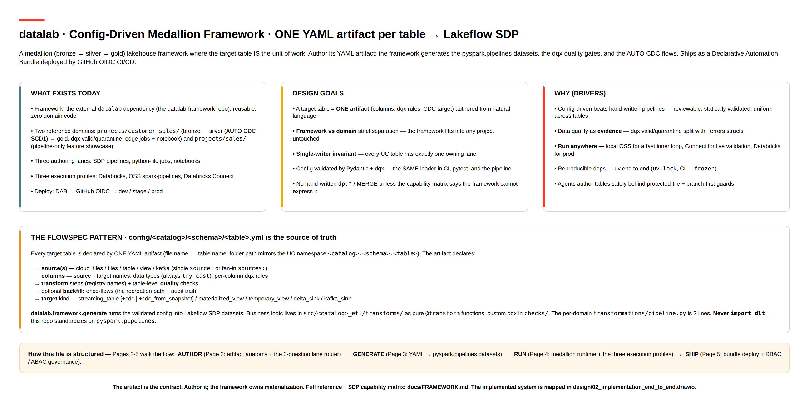
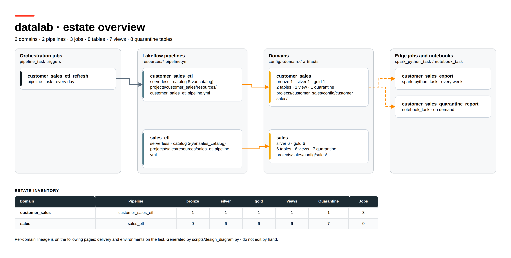
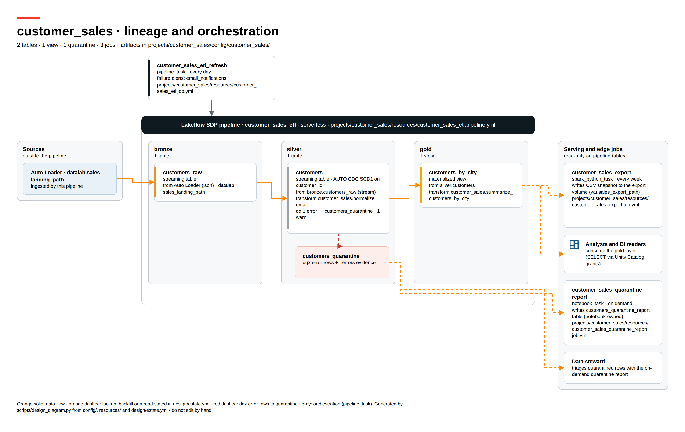
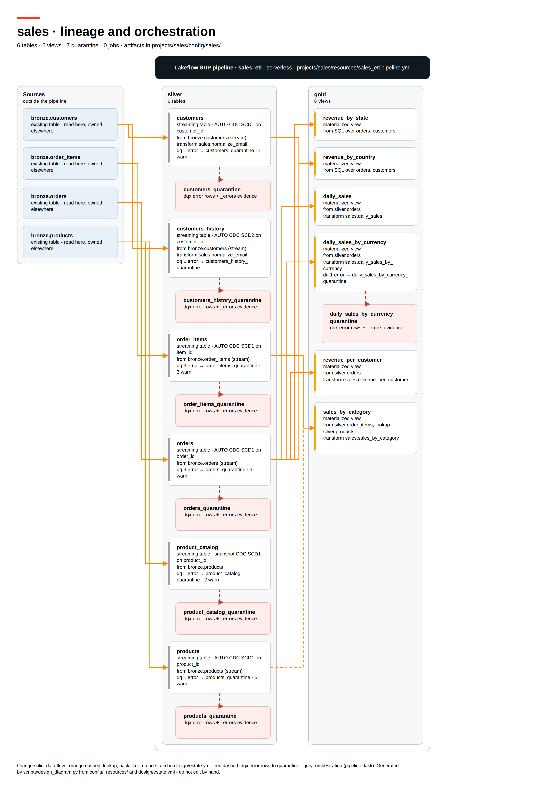
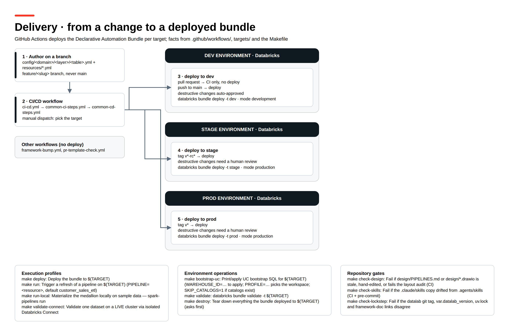
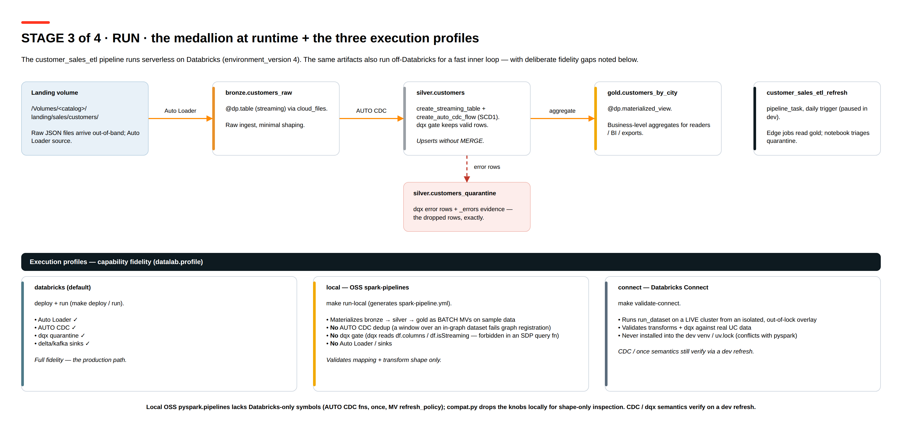
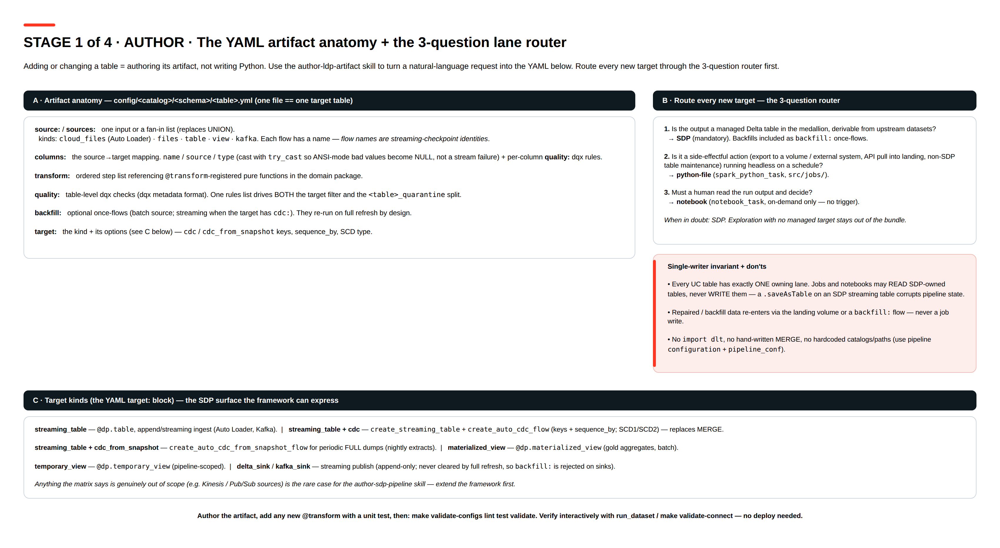
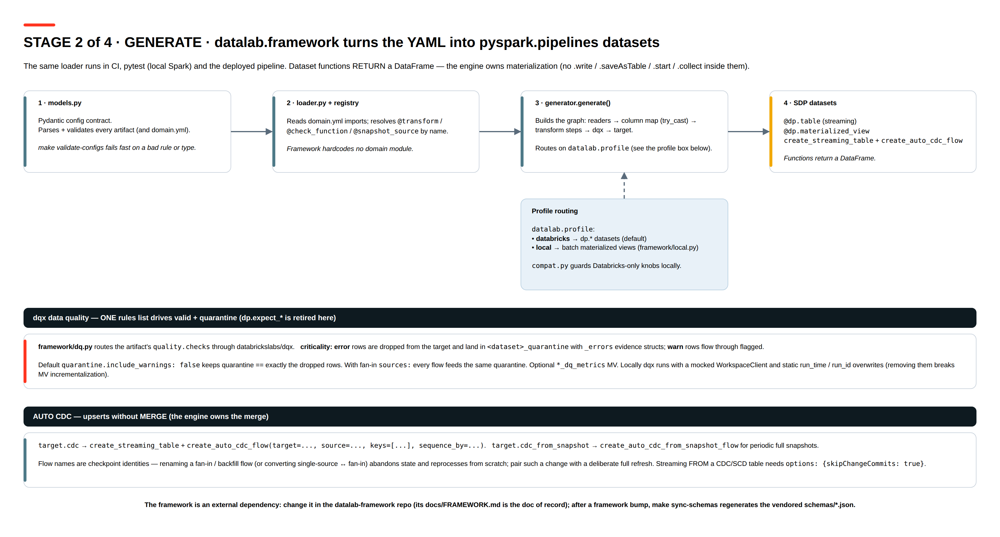
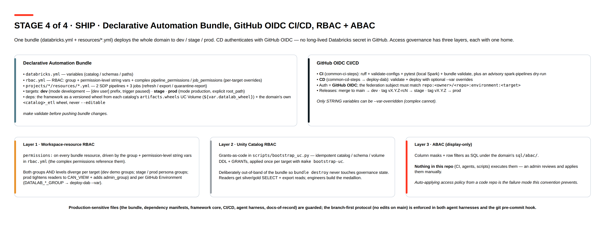

# datalab — A Config-Driven Framework for Medallion Transformations on Databricks

**datalab turns every table in your bronze → silver → gold lakehouse into a single,
reviewable YAML file.** A data engineer (or an AI coding agent) describes *what* a
table should contain — its source, its columns and types, its data-quality rules, and
how it merges — and the framework generates the running
**Lakeflow Spark Declarative Pipeline** (the successor to DLT), wires up data quality,
handles change-data-capture, and ships the whole thing to Databricks through automated
CI/CD. No hand-written PySpark plumbing. No `MERGE` statements. No copy-pasted notebooks.

> This document is a guided tour of the framework and how it drives transformations
> across the layers of the medallion architecture. The diagrams are exported from the
> editable sources in this `design/` folder.

---

## Executive summary

| | |
|---|---|
| **What it is** | A reusable framework that builds a medallion lakehouse (bronze → silver → gold) on **Lakeflow Spark Declarative Pipelines (SDP)**, where each target table is declared as **one YAML artifact** instead of bespoke pipeline code. |
| **The core promise** | *The table is the unit of work.* Adding or changing a table is a config edit a reviewer can read in a pull request — not a code change only a Spark specialist can audit. |
| **Who it's for** | Data platform teams that want a **standardized, governed, repeatable** way to onboard many tables and many domains onto Databricks without each one becoming a snowflake pipeline. |
| **What you get** | Faster delivery, uniform data-quality enforcement, built-in change-data-capture, environment promotion (dev → stage → prod) with zero code edits, and a clean separation between the *framework* and your *business logic*. |

**Why it matters for the medallion:** every layer transition — raw ingest into bronze,
cleansing/validation/deduplication into silver, business aggregates into gold — follows
the *same* declarative pattern. Engineers learn one model and apply it everywhere; the
framework guarantees the hard parts (quality gating, CDC, schema-safe casts, quarantine
of bad rows) are done consistently.

---

## The core idea: the table is the unit of work



*The conceptual model: every target table is declared by ONE YAML artifact whose folder
path mirrors the Unity Catalog namespace (`config/<catalog>/<schema>/<table>.yml`). The
framework — not the engineer — owns how that declaration becomes a running pipeline.*

Each artifact declares only the *intent*:

- **source(s)** — cloud files (Auto Loader), files, a table, a view, or Kafka; a single
  source or a fan-in list that replaces hand-written `UNION`s.
- **columns** — the source → target mapping with data types. Casts are **ANSI-safe**
  (`try_cast`), so malformed values become `NULL` for the quality rules to catch instead
  of crashing the stream.
- **quality** — per-column and table-level data-quality rules in
  [databrickslabs/dqx](https://databrickslabs.github.io/dqx/) format.
- **transform** — an ordered list of pure, unit-tested business functions (registered by
  name; they live in your domain package, not in the framework).
- **target** — the kind of table to build: a streaming table (optionally with CDC /
  SCD), a materialized view, a temporary view, or a sink.

Everything else — reading the source, applying the casts, running the quality checks,
splitting valid from quarantined rows, performing the merge, and materializing the
table — is the framework's job.

---

## End-to-end architecture



*The estate at a glance, generated from the repository itself (`config/`, `resources/`,
`targets/`): two domains, each built by one serverless Lakeflow SDP pipeline. The
per-domain pages below trace every table from its source to its consumers.*



*The worked `customer_sales` example: Auto Loader lands raw files in bronze, silver
upserts them with AUTO CDC behind a dqx gate that diverts failing rows to quarantine,
and gold aggregates for readers. The daily refresh job orchestrates the pipeline;
the export job and the quarantine-report notebook only ever READ pipeline tables.*



*The second, pipeline-only domain (`sales_etl`) - silver + gold over pre-existing
`sales.bronze.*` tables — showing one framework serving more than one medallion, and
doubling as the feature showcase: SCD2 history tables, SCD from full snapshots
(`cdc_from_snapshot`), domain-wide operational-metadata stamping, and config templates
that expand one parameterized spec into N gold tables.*



The flow in one sentence: **a YAML artifact is validated and generated by the framework
into a Lakeflow SDP pipeline whose tables stream landing → bronze → silver → gold, with
bad rows diverted to quarantine, deployed to Databricks by an automated, secret-less
CI/CD pipeline.**

---

## Driving transformations across the medallion

This is the heart of the framework. The same declarative pattern carries data through
every layer; each artifact below is a real file from the `customer_sales` example.



### Bronze — ingest raw, preserve the source

The bronze artifact does one thing: incrementally ingest the raw feed and keep the source
shape (schema evolution on, no column mapping yet).

```yaml
# config/customer_sales/bronze/customers_raw.yml
name: customers_raw
source:
  kind: cloud_files          # Auto Loader — incremental file ingestion
  path_conf: datalab.sales_landing_path
  format: json
  options:
    cloudFiles.schemaEvolutionMode: addNewColumns
  add_lineage: true          # framework adds _ingest_ts + _source_file
target:
  kind: streaming_table
```

**What the framework does:** stands up a streaming table fed by Auto Loader and stamps
each row with ingestion lineage (`_ingest_ts`, `_source_file`).

### Silver — validate, clean, deduplicate, and upsert

The silver artifact is where most of the value lives: the source → target column mapping
with types, per-column and table-level **data-quality rules**, a **transform** step, and
an **AUTO CDC** target that performs the upsert.

```yaml
# config/customer_sales/silver/customers.yml
name: customers
source:
  kind: table
  name: customers_raw
  layer: bronze              # resolved via domain.yml — no hardcoded schema
  as_stream: true
columns:
  - name: customer_id
    type: string
    quality:
      - criticality: error   # rows without an id never reach silver → quarantined
        check: { function: is_not_null }
  - name: age
    type: int                # malformed values become NULL (try_cast), not failures
  - name: email
    type: string
    quality:
      - criticality: warn    # flagged but allowed through
        filter: email IS NOT NULL
        check:
          function: regex_match
          arguments:
            regex: '^[A-Za-z0-9._%+-]+@[A-Za-z0-9.-]+\.[A-Za-z]{2,}$'
transform:
  - function: customer_sales.normalize_email   # pure, unit-tested business logic
quality:
  quarantine:
    include_warnings: false  # quarantine == exactly the dropped rows
target:
  kind: streaming_table
  cdc:
    keys: [customer_id]      # AUTO CDC — no hand-written MERGE
    sequence_by: _ingest_ts
    scd_type: 1
```

**What the framework does, automatically:**

- **Schema-safe casts.** Every column is cast with `try_cast`, so a bad `age` becomes
  `NULL` (which a quality rule can flag) instead of failing the whole stream under Spark's
  ANSI mode.
- **Quality gating + quarantine.** `error`-criticality rows are dropped from the target
  and routed to `customers_quarantine` with `_errors` evidence structs explaining *why*.
  `warn` rows flow through, flagged. **Rows are never silently lost.**
- **Change-data-capture without MERGE.** The `cdc:` block generates an
  *AUTO CDC* flow that upserts by key (`scd_type: 1` keeps the current record;
  `scd_type: 2` would keep history) — replacing fragile hand-written `MERGE` logic.

### Gold — business aggregates

Gold tables are concise: point at the upstream silver table and name the aggregation
function.

```yaml
# config/customer_sales/gold/customers_by_city.yml
name: customers_by_city
source:
  kind: table
  name: customers
  layer: silver
transform:
  - function: customer_sales.summarize_customers_by_city
target:
  kind: materialized_view    # batch-refreshed business aggregate
```

### The result

```
landing volume ──Auto Loader──▶ bronze.customers_raw
                                      │
                                      ▼
                          (8 mapped cols + normalize_email)
                                      │
                          dqx checks ─┴─▶ valid ──AUTO CDC (SCD1)──▶ silver.customers
                                      └─▶ error rows ──▶ silver.customers_quarantine
                                                                          │
                                          silver.customers ──aggregate──▶ gold.customers_by_city
```

Adding *your* next table — at any layer — is the same move: write one artifact, and
(rarely) one small pure transform function with a unit test. The medallion grows table by
table, each one reviewable in a pull request.

---

## How it works, stage by stage

The conceptual design walks through four stages. Each is one page of
`01_design_config_driven_medallion.drawio` in this folder.

### 1 · Author — describe the table in YAML



Authoring is config, not code. A built-in **3-question router** keeps every new target in
the right lane:

1. *A managed Delta table derivable from upstream data?* → **declarative pipeline** (the
   default — bronze/silver/gold all live here).
2. *A headless side-effect (export to a volume, pull from an API)?* → a **Python job**.
3. *Must a human read the output and decide?* → a **notebook** (on-demand only).

A **single-writer invariant** guarantees each table has exactly one owner, so pipelines
and jobs never fight over the same table.

### 2 · Generate — YAML becomes a pipeline



The framework validates the artifact (with Pydantic — bad rules or types fail *before*
anything runs) and generates the pipeline datasets: readers → column casts → transforms →
quality checks → writers. Data quality is routed through dqx; upserts through AUTO CDC.
The same generator runs in CI, in unit tests, and in the deployed pipeline — so what you
test is what you ship.

### 3 · Run — anywhere, with the right fidelity

The medallion runs **serverless on Databricks** for production. Crucially, the *same
artifacts* also run in two lighter profiles for a fast development loop:

| Profile | Where | Use it for |
|---|---|---|
| **databricks** | Serverless SDP on Databricks | Full fidelity — the production path (Auto Loader, AUTO CDC, quarantine, sinks). |
| **local** | Open-source `spark-pipelines` on your laptop | A fast inner loop — validates mapping + transform shape on sample data, no Databricks needed. |
| **connect** | Databricks Connect | Validates transforms against a live cluster and real Unity Catalog data. |

This "run anywhere" design means engineers iterate in seconds locally and validate against
real data before deploying — without changing a single line of the artifact.

### 4 · Ship — deploy and govern



The whole domain deploys as a **Declarative Automation Bundle** to `dev`, `stage`, and
`prod` targets — the same artifacts, parameterized per environment through bundle
variables (no code edits to promote). CI/CD runs on **GitHub OIDC** (no long-lived
Databricks secret stored in GitHub). Governance has three clear homes:

- **Workspace RBAC** — who can run/manage pipelines and jobs (per-environment groups and
  permission levels).
- **Unity Catalog RBAC** — who can read/write the data (grants-as-code, applied
  out-of-band so a teardown never erases governance).
- **ABAC** — row filters and column masks (display-only SQL an admin reviews and applies).

---

## Why customers choose datalab

- **Speed with safety.** New tables ship as config a reviewer can read; the framework
  enforces the hard parts the same way every time.
- **Quality is not optional.** Every layer can gate on dqx rules, and dropped rows are
  always captured in a quarantine table with evidence — auditable, never silently lost.
- **CDC built in.** Upserts and slowly-changing dimensions come from a declarative
  `cdc:` block, not error-prone hand-written merges.
- **No environment drift.** One set of artifacts promotes dev → stage → prod through
  variables; catalogs, schemas, and paths are never hardcoded.
- **No lock-in to a single runtime.** The same definitions run locally on open-source
  Spark, against a live cluster via Connect, and serverless on Databricks.
- **Framework vs. business logic, cleanly separated.** The reusable framework lifts into
  any project untouched; your domain logic stays in your own package and is unit-tested.
- **Agent- and human-friendly.** Because tables are declarative YAML, AI coding agents can
  author and modify them safely behind branch-first and protected-file guards.

---

## Adopting datalab

Getting a new domain from an empty folder to a deployed pipeline is a copy-and-fill
exercise:

1. **Copy the worked example.** `projects/customer_sales/` is a complete adoption laid out
   exactly like a real domain repo — config + domain package + jobs + notebook + resources
   + tests.
2. **Point it at your catalog/schemas** via bundle variables (folder names mirror the
   Unity Catalog namespace, so the structure documents itself).
3. **Author your tables** — one artifact per table, starting at bronze and working up.
   Add a pure transform function only when business logic is genuinely needed.
4. **Validate locally** (`make validate-configs`, `make test`), then **deploy** to dev and
   refresh the pipeline.
5. **Promote** to stage and prod by tagging a release — the same artifacts, no edits.

A new table on an existing pipeline is typically **one YAML file** (plus, occasionally,
one small tested function). A new domain is a folder copy plus configuration.

---

## Where to go deeper

| Topic | Document |
|---|---|
| Repository tour and quick start | [`README.md`](../README.md) |
| Empty folder → deployed pipeline, step by step | [`docs/GETTING_STARTED.md`](../docs/GETTING_STARTED.md) |
| Full artifact reference + capability matrix | [`docs/FRAMEWORK.md`](../docs/FRAMEWORK.md) |
| System design, lanes, code layout, governance | [`docs/ARCHITECTURE.md`](../docs/ARCHITECTURE.md) |
| CI/CD, OIDC setup, release flow | [`docs/CICD.md`](../docs/CICD.md) |
| Folder ↔ Unity Catalog naming convention | [`docs/NAMING.md`](../docs/NAMING.md) |
| The complete worked example | [`projects/customer_sales/`](../projects/customer_sales/README.md) |
| Editing / re-exporting these diagrams | [`docs/ARCHITECTURE.md` → Editing the design diagrams](../docs/ARCHITECTURE.md#editing-the-design-diagrams) |

---

## Glossary

- **Medallion architecture** — the bronze (raw) → silver (cleaned/validated) → gold
  (business-ready) layering of a lakehouse.
- **Artifact / flowspec** — the single YAML file that declares one target table.
- **Lakeflow SDP** — Spark Declarative Pipelines (`pyspark.pipelines`), the successor to
  DLT; the engine owns table materialization.
- **AUTO CDC** — declarative change-data-capture (upserts / SCD) generated from the
  artifact's `cdc:` block, replacing hand-written `MERGE`.
- **dqx** — `databrickslabs/dqx`, the data-quality library; rules live in the artifact and
  drive both the target filter and the quarantine split.
- **Quarantine** — the companion table that captures rows dropped by `error`-criticality
  rules, with `_errors` evidence explaining the failure.
- **DAB** — Declarative Automation Bundle (formerly Databricks Asset Bundle), the
  deployment unit.

---

*Diagrams in this document are generated: `design/02_implementation_end_to_end.drawio` is
built from the estate itself and `design/01_design_config_driven_medallion.drawio` from
the design spec, both exported page by page to `design/images/` by `make design` (see the
architecture doc link above). They are never edited by hand.*
