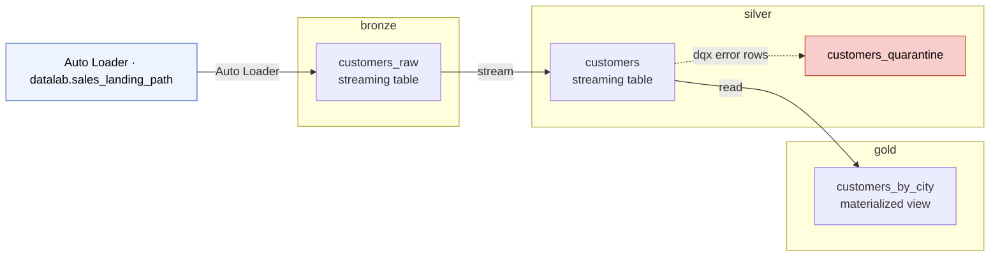
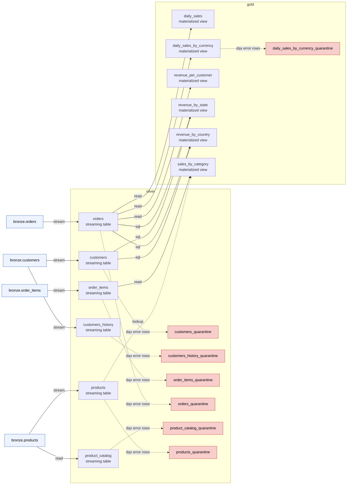

<!-- GENERATED by scripts/design_inventory.py (`make design`) from the config/ artifacts — do not edit by hand; `make check-design` (CI) fails while it is stale. -->

# Pipeline inventory

Every target table the `config/` artifacts declare, per domain: where its
rows come from, what kind of dataset it is and its data-quality gate. Solid
arrows are reads, dashed arrows are lookups/backfills, red nodes are dqx
quarantine tables. Regenerate with `make design` after adding or changing a
table — CI's `make check-design` fails while this page is stale.

## `customer_sales` — `projects/customer_sales/config/customer_sales/`

| Layer | Table | Built from | Target | Quality gate | Transforms | Config |
|---|---|---|---|---|---|---|
| bronze | `customers_raw` | Auto Loader (json) · `datalab.sales_landing_path` | streaming table | — | — | [`bronze/customers_raw.yml`](../projects/customer_sales/config/customer_sales/bronze/customers_raw.yml) |
| silver | `customers` | `bronze.customers_raw` (stream) | streaming table · AUTO CDC SCD1 on `customer_id` | 1 error → `customers_quarantine` · 1 warn | `customer_sales.normalize_email` | [`silver/customers.yml`](../projects/customer_sales/config/customer_sales/silver/customers.yml) |
| gold | `customers_by_city` | `silver.customers` | materialized view | — | `customer_sales.summarize_customers_by_city` | [`gold/customers_by_city.yml`](../projects/customer_sales/config/customer_sales/gold/customers_by_city.yml) |

## `sales` — `projects/sales/config/sales/`

| Layer | Table | Built from | Target | Quality gate | Transforms | Config |
|---|---|---|---|---|---|---|
| silver | `customers` | `bronze.customers` (stream) | streaming table · AUTO CDC SCD1 on `customer_id` | 1 error → `customers_quarantine` · 1 warn | `sales.normalize_email` | [`silver/customers.yml`](../projects/sales/config/sales/silver/customers.yml) |
| silver | `customers_history` | `bronze.customers` (stream) | streaming table · AUTO CDC SCD2 on `customer_id` | 1 error → `customers_history_quarantine` | `sales.normalize_email` | [`silver/customers_history.yml`](../projects/sales/config/sales/silver/customers_history.yml) |
| silver | `order_items` | `bronze.order_items` (stream) | streaming table · AUTO CDC SCD1 on `item_id` | 3 error → `order_items_quarantine` · 3 warn | — | [`silver/order_items.yml`](../projects/sales/config/sales/silver/order_items.yml) |
| silver | `orders` | `bronze.orders` (stream) | streaming table · AUTO CDC SCD1 on `order_id` | 3 error → `orders_quarantine` · 3 warn | — | [`silver/orders.yml`](../projects/sales/config/sales/silver/orders.yml) |
| silver | `product_catalog` | `bronze.products` | streaming table · snapshot CDC SCD1 on `product_id` | 1 error → `product_catalog_quarantine` · 2 warn | — | [`silver/product_catalog.yml`](../projects/sales/config/sales/silver/product_catalog.yml) |
| silver | `products` | `bronze.products` (stream) | streaming table · AUTO CDC SCD1 on `product_id` | 1 error → `products_quarantine` · 5 warn | — | [`silver/products.yml`](../projects/sales/config/sales/silver/products.yml) |
| gold | `daily_sales` | `silver.orders` | materialized view | — | `sales.daily_sales` | [`gold/daily_sales.yml`](../projects/sales/config/sales/gold/daily_sales.yml) |
| gold | `daily_sales_by_currency` | `silver.orders` | materialized view | 1 error → `daily_sales_by_currency_quarantine` | `sales.daily_sales_by_currency` | [`gold/daily_sales_by_currency.yml`](../projects/sales/config/sales/gold/daily_sales_by_currency.yml) |
| gold | `revenue_per_customer` | `silver.orders` | materialized view | — | `sales.revenue_per_customer` | [`gold/revenue_per_customer.yml`](../projects/sales/config/sales/gold/revenue_per_customer.yml) |
| gold | `revenue_by_state` | SQL over `orders`, `customers` | materialized view | — | — | [`gold/revenue_rollups.yml`](../projects/sales/config/sales/gold/revenue_rollups.yml) |
| gold | `revenue_by_country` | SQL over `orders`, `customers` | materialized view | — | — | [`gold/revenue_rollups.yml`](../projects/sales/config/sales/gold/revenue_rollups.yml) |
| gold | `sales_by_category` | `silver.order_items`; lookup `silver.products` | materialized view | — | `sales.sales_by_category` | [`gold/sales_by_category.yml`](../projects/sales/config/sales/gold/sales_by_category.yml) |
