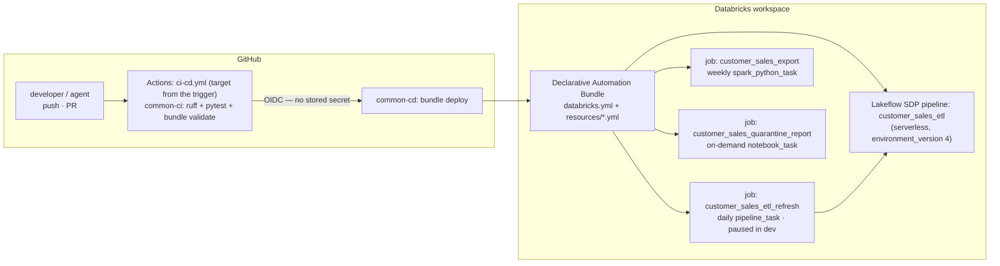
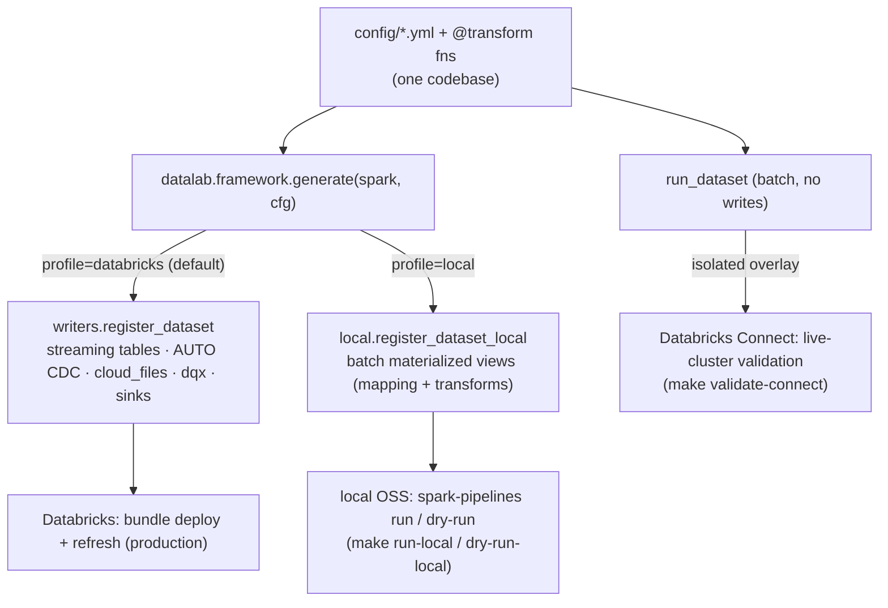
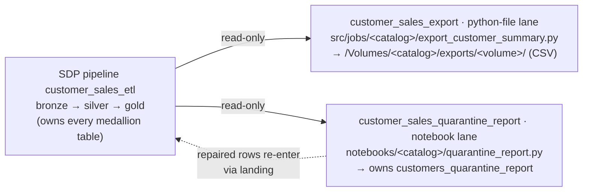
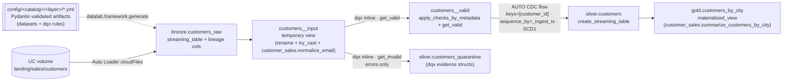
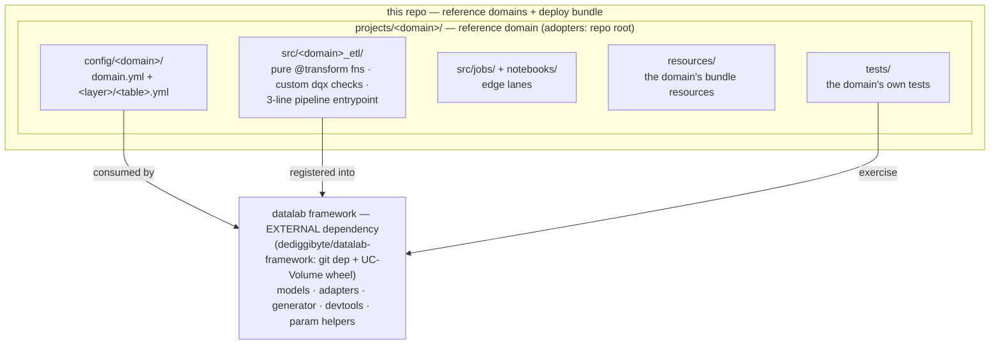
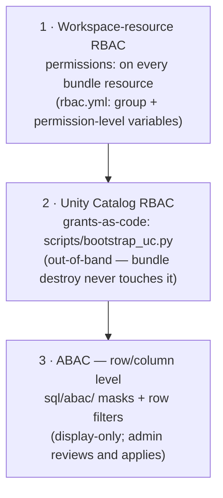

# Architecture

<!-- template-only:arch-nav start -->
[← README](../README.md) · **Architecture** · [Framework](FRAMEWORK.md) · [CI/CD](CICD.md) · [Migration](MIGRATION.md)
<!-- template-only:arch-nav end -->

How datalab hangs together: from a GitHub push to running Lakeflow resources,
the three authoring lanes, the medallion data view, code organization, and
governance.

<!-- template-only:arch-design-banner start -->
> Generated architecture diagrams (draw.io, built from the estate) live in `design/` —
> see [Editing the design diagrams](#editing-the-design-diagrams) for how to
> regenerate, preview and keep them in sync with the code.
<!-- template-only:arch-design-banner end -->

## System view

<!-- template-only:arch-system-view start -->

<!-- template-only:arch-system-view end -->

The bundle is the only thing that touches the workspace. CI validates it on
every PR; CD deploys it on merge (dev) and tags (stage/prod) — details in
[CICD.md](CICD.md).

<!-- adopter-if:local-dev start -->
## Execution profiles (run anywhere)

One config-driven codebase runs three ways; `datalab.profile` (a pipeline
`configuration` value, default `databricks`) selects the graph. Only the
Databricks profile is the deploy/production path — the other two are local
development aids. Details + fidelity caveats: the framework repo's
[FRAMEWORK.md](https://github.com/dediggibyte/datalab-framework/blob/v1.0.0/docs/FRAMEWORK.md)
"Run anywhere".



- **Databricks** — the bundle deploys the full Lakeflow graph; the only profile
  that runs AUTO CDC, Auto Loader, dqx quarantine and sinks for real.
- **Local OSS** (`datalab.framework.local`) — downgrades to a batch
  materialized-view graph the `spark-pipelines` CLI runs on sample data; no
  AUTO CDC dedup / dqx / Auto Loader (OSS SDP can't express them).
- **Databricks Connect** — runs one dataset's mapping/transforms/dqx via
  `run_dataset` on a live cluster from an isolated, out-of-lock overlay.
<!-- adopter-if:local-dev end -->

## Three authoring lanes

The SDP pipeline owns **all medallion tables** (single-writer invariant).
Jobs work the lakehouse edges and only *read* pipeline-owned tables:

<!-- template-only:arch-lanes-diagram start -->

<!-- template-only:arch-lanes-diagram end -->

Routing is the 3-question router (AGENTS.md, "Authoring rules"):

| New target is… | Lane | Mechanism |
|---|---|---|
| a managed medallion Delta table | **SDP via YAML config** (mandatory) | `config/<catalog>/<schema>/<table>.yml`; backfills via `backfill:` once-flows |
| headless, side-effectful edge work | **python-file** | `spark_python_task`: argparse + explicit `main()` |
| human-must-decide | **notebook** | `notebook_task`, no trigger; widgets mirror job parameters |

<!-- template-only:arch-data-view start -->
## Data view (medallion, generated from the customer_sales example's artifacts)


<!-- template-only:arch-data-view end -->

Developers (and agents) edit YAML only; the framework validates configs with
Pydantic at pipeline import and registers every LDP object through
reader/writer adapters; data quality is databrickslabs/dqx end to end. The
artifact schema and semantics — including fan-in `sources:`, `backfill:`
once-flows, snapshot CDC, kafka in/out, and the SDP capability matrix — are in
the framework repo's [FRAMEWORK.md](https://github.com/dediggibyte/datalab-framework/blob/v1.0.0/docs/FRAMEWORK.md).

## Code organization

<!-- template-only:arch-code-diagram start -->

<!-- template-only:arch-code-diagram end -->

Layer rules, deliberately separated:

1. **The `datalab` framework** — an EXTERNAL dependency (the `datalab-framework`
   repo), consumed as a git dep (local/CI) + a versioned UC-Volume wheel
   (serverless, `${var.datalab_wheel}` — never `--editable`). Models, adapters,
   generator, devtools, param helpers; never contains domain code or hardcoded
   domain module paths. Its unit tests live in that repo.
<!-- template-only:arch-layer-rule start -->
2. **`projects/<domain>/`** — complete reference domains, each mirroring an
   adopter repo root (`projects/README.md` has the mapping table): the YAML
   artifacts (`config/<domain>/`), the domain package (`src/<domain>_etl/`),
   the edge-lane entry points (`src/jobs/<domain>/`, `notebooks/<domain>/`),
   the domain's bundle `resources/` (relative paths, so the folder
   transplants to an adopter repo unchanged), and its own `tests/`.
<!-- template-only:arch-layer-rule end -->
3. **Parameterization, one fail-fast contract per lane**, no hardcoding
   anywhere: bundle variables → pipeline `configuration:` →
   `pipeline_conf(spark, key)` (SDP); bundle variables → job `parameters:` →
   widgets → `datalab.params.notebook_params` (notebook) or argv flags →
   `datalab.params.cli_params` (python-file).

Quality: dqx checks are defined per dataset in the layer YAML. The same list
drives the target's valid-row filter and the quarantine table, so the two can
never diverge; evidence lands as `_errors`/`_warnings` structs.

## Environments

<!-- template-only:arch-env-table start -->
| Target | Mode | Catalog (default) | Trigger state |
|---|---|---|---|
| dev | development — resources prefixed `[dev <user>]`, isolated per user | `customer_sales` | paused |
| stage | production | `customer_sales_stage` | live |
| prod | production | `customer_sales_prod` | live |
<!-- template-only:arch-env-table end -->

Catalogs and schemas are bundle variables; the same artifacts deploy to all
three targets unchanged.

## Access governance (RBAC / ABAC)

Three layers, each with one home:



- **Layer 1** controls who can run/manage pipelines and jobs: `permissions:`
  on every resource, driven by the group (`reader_group` / `engineer_group` /
  `admin_group`) and permission-level (`*_pipeline_level` / `*_job_level`)
  string variables in `rbac.yml` (include'd by `databricks.yml`, which keeps
  only the medallion variables). Both the groups AND their levels diverge per
  target (dev uses demo groups with broad levels; stage/prod use the
  `dl_sales_*` persona groups; prod tightens readers to `CAN_VIEW` and adds an
  `admin_group`) and per GitHub Environment (`DATALAB_READER_GROUP` /
  `DATALAB_ENGINEER_GROUP` repo variables → `deploy-dab` `--var`).
- **Layer 2** controls who can read/write the data: grants-as-code in
  `scripts/bootstrap_uc.py` — idempotent catalog/schema/volume DDL + GRANTs,
  applied once per target with `make bootstrap-uc`. Deliberately out-of-band
  of the bundle so `bundle destroy` never touches governance state. Readers
  get silver/gold SELECT + export-volume reads; engineers get medallion
  build rights; bronze/landing stay engineer-only.
- **Layer 3** is row/column-level policy: column masks and row filters under
  the domain's `sql/abac/` folder (this repo:
  `sql/abac/`). Display-only by convention — agents and CI
  never execute them; an admin reviews and applies. SDP does offer a
  pipeline-level `row_filter`/column-mask surface (Public Preview); this
  repo deliberately does not use it — access policy stays admin-applied,
  out of the deploy path. Allowed constructs:
  `CREATE FUNCTION ... RETURN`, `ALTER TABLE ... SET MASK / SET ROW FILTER`,
  `is_account_group_member()`, `current_user()`. Re-runnable, function
  before ALTER, named `dl_mask_<purpose>` / `dl_rf_<purpose>`. Worked
  example: `sql/abac/mask_customer_email.sql`.

Group creation stays manual, and the SCOPE matters: UC grants need **account** groups (`databricks account groups create`), while pipeline/job ACLs resolve **workspace** groups (`databricks groups create`). A workspace-local group can never hold a UC privilege —
nothing in this repo creates principals.

<!-- template-only:arch-design-section start -->
## Editing the design diagrams

The `design/` folder is the living picture of the estate this repo deploys plus
a customer-facing overview. The diagrams are **generated, never hand-edited**:
`scripts/design_diagram.py` builds them from the estate through the vendored
**drawio-architecture-designer** kit (`scripts/drawio_kit/`,
`.agents/skills/drawio-architecture-designer/`) - one layout model emitted as
the `.drawio` file plus an HTML twin, cards sized from their text, arrows
routed shape to shape through gutter lanes and corridors, and a layout audit
that must be clean before anything is written. `design/` is listed in
`.databricksignore`, so none of it ships with the bundle.

| Path | Kind | Changes when |
|---|---|---|
| `design/02_implementation_end_to_end.drawio` | **Generated** estate map: 1 estate overview (domains, pipelines, jobs + inventory table) · one lineage page per domain (sources, layers, quarantine, orchestration, edge jobs, consumers) · delivery (CI/CD triggers → bundle targets, profiles, gates) | any change to `config/`, `resources/*.yml`, `targets/`, `ci-cd.yml`, the Makefile help or `design/estate.yml` - `make design` |
| `design/01_design_config_driven_medallion.drawio` | **Generated** design spec (Context → Author → Generate → Run → Ship) from the text in `scripts/design_spec.py` | the *design intent* changes - edit that text, `make design` |
| `design/estate.yml` | **Hand-written** overlay: upstream source systems, downstream consumers, edge-job reads/writes | a relationship exists that no bundle YAML states |
| `design/images/*.png` | **Generated** PNG exports (one per page) | never by hand - `make design` |
| `design/PIPELINES.md` | **Generated** pipeline inventory + mermaid lineage from `config/` (`scripts/design_inventory.py`) | every table change - `make design` |
| `design/OVERVIEW.md` | Customer-facing tour that embeds the images | the customer narrative changes |
| `design/datalab-customer-overview.html` | Standalone self-contained share (built out-of-band) | `OVERVIEW.md` changes materially - regenerate separately; never hand-edit |

### Regenerate, look, commit

```bash
make design            # PIPELINES.md + both .drawio files + design/images/*.png
make design-preview    # HTML twin + one PNG per page in .design-preview/ (gitignored)
make check-design      # what CI and the pre-commit hook run
```

`make design` renders the PNGs with the draw.io Desktop CLI when it is
installed (set `DRAWIO=/path/to/draw.io` if it isn't on `PATH` or at the default
macOS location; `scripts/export_design.py` splits multi-page files page by page,
working around draw.io's unreliable `--page-index`), otherwise from the kit's
HTML twin via playwright, otherwise it skips the images with a note. Read every
changed page of `make design-preview` before committing - the audit finds size
mistakes; only looking finds ugly. Commit the regenerated files with the change
that caused them.

### Why hand edits fail

Opening a `.drawio` in draw.io (or the *Draw.io Integration* extension) is fine
for **viewing**. Saving it, or patching its XML, is not:
`.cursor/hooks/design_drawio_guard.py` denies agent writes to `design/*.drawio`
and `design/images/*.png` in Claude Code, Codex and Cursor, and
`make check-design` regenerates both diagrams in memory and fails on any
difference - as well as on any layout-audit finding (text overflowing its card
or too wide to wrap, non-black text, colliding cards, an arrow crossing a card
it does not connect, two unrelated arrows drawn on top of each other). To change
what a diagram shows, change the estate or `design/estate.yml`; to change how
it looks, change `scripts/design_diagram.py` / `scripts/design_spec.py`
following the `drawio-architecture-designer` skill.

### Keep the design in sync with the code

Updating the design is part of the maintenance contract (AGENTS.md "Coding-agent
maintenance protocol", step 2): in the **same PR** as an estate change, run
`make design`, look at the preview, and refresh `design/OVERVIEW.md` if the
customer story changed. The `maintain-design-diagram` skill
(`.agents/skills/maintain-design-diagram/SKILL.md`) is the step-by-step recipe.
`design/datalab-customer-overview.html` is a standalone share built
out-of-band; regenerate it separately when `OVERVIEW.md` changes materially.

---

Keep this document in sync with reality — it is part of the protected
documents-of-record surface (see AGENTS.md).
<!-- template-only:arch-design-section end -->
