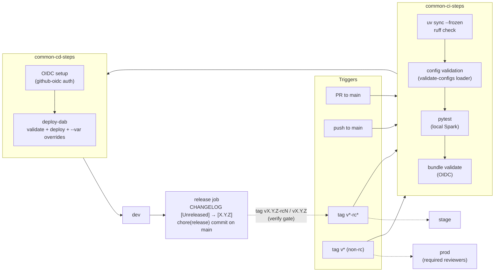
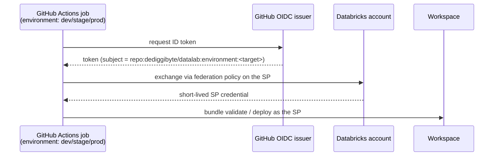
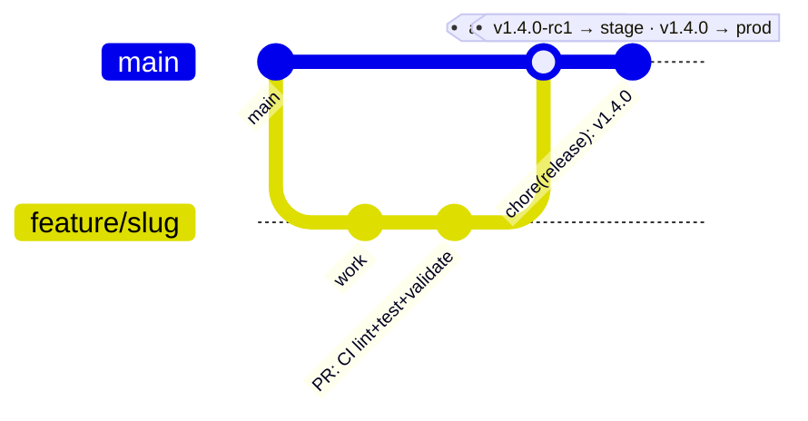

# CI/CD

[← README](../README.md) · [Architecture](ARCHITECTURE.md) · [Framework](FRAMEWORK.md) · **CI/CD** · [Migration](MIGRATION.md)

GitHub Actions + GitHub OIDC + Declarative Automation Bundles. No long-lived
Databricks secrets are stored in GitHub.

## Pipeline view



## Workflows

| Workflow | Trigger | What runs |
|---|---|---|
| `ci-cd.yml` | PRs to `main` (CI only, vs dev); pushes to `main` (CI + deploy dev + changelog release); `v*-rc*` tags (stage); `v*` tags (prod); manual with a target choice | ONE workflow for every target — a `params` job derives the target/deploy flags from the trigger (and refuses a stage/prod deploy of anything but a cut release), then calls the common CI/CD workflows; after a deploy of `main` the `release` job cuts the changelog — see "Changelog releases" |
| `framework-bump.yml` | twice-daily schedule, manual (optional dry run), `repository_dispatch` `datalab-framework-released` | watches `datalab-framework` for a new `vX.Y.Z` release and opens the MANDATORY bump PR (`make bump-framework`: pyproject tag + `var.datalab_version` + `uv.lock` + regenerated `schemas/` + re-pinned framework-doc links), with every CI gate's result and the framework CHANGELOG between the pins in its body — a DRAFT when the release needs corresponding changes; see "Framework bumps" | <!-- adopter-if:framework-bot -->
| `pr-template-check.yml` | every PR | enforces the unified PR template | <!-- adopter-if:pr-template -->

<!-- adopter-if:dependabot start -->
Dependabot (`.github/dependabot.yml`) keeps the GitHub Actions pins and regular
Python dev deps fresh; the framework pin is deliberately excluded there —
`make bump-framework` owns that multi-file lockstep.
<!-- adopter-if:dependabot end -->

Reusable pieces:

- `common-ci-steps.yml` — `uv sync --frozen` → `ruff check` (the same paths as
  `make lint`) → skill-mirror, templates-doc, framework-lockstep,
  vendored-schema, domain-registry and sync-list drift checks (the `make
  check-*` gates) → config validation (`python -m datalab.framework`, the
  `make validate-configs` loader) → `pytest` (local Spark, Java 21) →
  `databricks bundle validate -t <target>` (OIDC; skipped
  gracefully when the target's GitHub Environment has no Databricks secrets
  yet, same gate as CD). In the template repo it additionally runs the
  adopter-scaffold smoke test (both conversion modes into temp dirs, then the
  GENERATED repo's own quality gates + adopter invariants); that job is
  stripped from generated adopters, which have no scaffold to exercise.
- `common-cd-steps.yml` — OIDC setup → `deploy-dab` composite action
  (validate + deploy with optional `--var` overrides). **dev passes
  `auto-approve: true`** so CI can apply destructive changes (e.g. deleting a
  renamed pipeline and its STs/MVs) non-interactively — dev is
  `mode: development`, so a full refresh restores every ST/MV. `stage`/`prod`
  omit it (default `false`): a destructive plan there fails the deploy loudly for
  a human to review before any pipeline/table/volume is deleted.
- Composite actions: `.github/actions/databricks-setup` (CLI install +
  `~/.databrickscfg` with `auth_type = github-oidc`),
  `.github/actions/deploy-dab`.

## Framework bumps (mandatory in the template)

The datalab **template repo** (the repo every adopter starts from,
recognisable by its reference domains under `projects/`) must always run the **latest**
datalab-framework release, and a bump must carry the changes that release
needs. Both are enforced, not requested. A **generated adopter repo** inherits
the same gates in *warn* mode (its owners decide when to adopt); setting the
repo/org **variable** `DATALAB_FRAMEWORK_MANDATE=enforce` opts it into the
mandate.

| Gate | Fails when | Fix |
|---|---|---|
| `make check-framework-current` (CI job `framework pin is the latest release`, every PR + main) | a newer published `vX.Y.Z` GitHub Release exists than the pinned tag | merge the bot's bump PR (or `make bump-framework VERSION=x.y.z`) |
| `make check-lockstep` (CI) | the git tag, `var.datalab_version`, `uv.lock` or any framework-doc link disagree | `make bump-framework VERSION=x.y.z` |
| `make check-schemas` (CI) | `schemas/` differ from the pinned framework's models | `make sync-schemas` | <!-- adopter-if:schemas -->
| `make check-framework-surface` (CI + pre-commit) | the `author-ldp-artifact` skill misses a target/source kind of the pinned schema | document the new kind in the skill, `make sync-skills` | <!-- adopter-if:schemas&any-agent -->

<!-- adopter-if:framework-bot start -->
**The bot** (`framework-bump.yml`) opens the bump PR, and it adapts to what the
release needs:
- **Checks:** a cheap check job runs twice a day. It compares the pin with the
  newest *published* GitHub Release (a bare tag whose release workflow hasn't
  published yet doesn't count). The heavy bump job starts only when a bump is
  due and no bump PR is already open. Once the pin is current, the check job
  closes any leftover `framework-bump` tracking issues.
- **Gates:** the bump job runs `make bump-framework` (its failure is reported
  like any other gate, never a silent stop), then EVERY CI gate on the bumped
  tree, without stopping at the first failure.
- **The PR:** it pushes `chore/bump-datalab-framework-<version>` (force-pushed
  only when the branch holds nothing but bot commits; a human's commits are
  never overwritten) and opens the PR. The body lists the gate results, the
  framework CHANGELOG between the two pins, the BREAKING bullets to migrate and
  the new capabilities to document. If any gate fails, the PR is a **draft**
  labeled `needs-corresponding-changes`: push those changes to the branch, then
  mark it ready.
- **Older bump PRs:** only after the new PR exists, it closes older bump PRs
  that hold nothing but bot commits. A PR with human commits stays open with a
  pointer comment, and no branch is deleted.
- **CI:** it dispatches `ci-cd.yml` on the branch (`target=dev`, CI only),
  because PRs created with `GITHUB_TOKEN` trigger no workflows.
- **Any other failure** files or updates a `framework-bump` tracking issue, so a
  release is never left unadopted without a trace.

It depends on three things outside the code:

1. **Settings → Actions → General → Workflow permissions → "Allow GitHub Actions
   to create and approve pull requests"** must be ON (an org policy may have to
   allow it first). While it is off, the bot pushes the branch, files or updates
   a `framework-bump` issue with a one-click compare link, and fails loudly.
2. **Actions billing.** A job refused with "recent account payments have failed
   or your spending limit needs to be increased" never starts. That happened on
   2026-08-31 and 2026-09-21. Keep the spending limit and payment method
   healthy; the stale-pin gate still fails every PR in the meantime, so
   nothing slips through silently.
3. **The reader App credentials** (`DATALAB_FRAMEWORK_APP_CLIENT_ID` /
   `DATALAB_FRAMEWORK_APP_PRIVATE_KEY`, see below). Their absence failed the bot
   three days running in Aug 2026.

**Instant trigger (optional, not set up).** The bot accepts a
`repository_dispatch` (`event_type: datalab-framework-released`). A step at the
end of the framework's `release.yml` that sends it would make the bump PR
appear minutes after a release instead of at the next scheduled check. It needs
a token that can write to this repo, stored as a framework-repo secret. Nothing
sends it today; the schedule and the stale-pin gate make it optional.
<!-- adopter-if:framework-bot end -->

<!-- adopter-if:template start -->
**Break-glass (template only).** During an incident, a prod hotfix may need to
ship before a breaking framework release is adopted. Setting the repo or org
**variable** `DATALAB_FRAMEWORK_MANDATE=warn` downgrades both framework gates to
warnings. Delete it as soon as the bump merges; leaving it set disables the
mandate.
<!-- adopter-if:template end -->

## Private framework dependency (git auth)

`pyproject.toml` pins `datalab` to the **private** `dediggibyte/datalab-framework`
repo (`[tool.uv.sources]`, a `git+https://…@<tag>` URL). Both CI (`uv sync
--frozen`) and CD (the `deploy-dab` publish step builds the framework wheel from
that git dep, and `bundle deploy` resolves it) must clone it — and the built-in
`GITHUB_TOKEN` is scoped to THIS repo only, so it cannot.

This repo authenticates with a **read-only GitHub App** ("datalab-framework
reader") that mints a **short-lived installation token** (≈1 h, auto-revoked at
job end) in each run — no SSH deploy key, no PAT to rotate, not tied to a person,
scoped to exactly one repo. (Deploy keys were the old mechanism; some orgs disable
deploy keys entirely, which silently breaks them — the App avoids that.)

Set up once (org owner):

1. Create a **GitHub App** owned by the `dediggibyte` org (Settings → Developer
   settings → GitHub Apps → New): **Repository permissions → Contents: Read-only**
   (Metadata: Read-only is implicit); no webhook.
2. **Install** it on `dediggibyte/datalab-framework` only (Only select
   repositories).
3. Generate a **private key** (.pem, downloaded once) and note the **Client ID**
   (App → General → About, the `Iv23li…` string under the App ID — the action's
   preferred identifier; the numeric App ID is deprecated).
4. On this repo (and each adopter repo), set:
   - **`DATALAB_FRAMEWORK_APP_CLIENT_ID`** — an Actions **variable** (the App's Client ID);
   - **`DATALAB_FRAMEWORK_APP_PRIVATE_KEY`** — an Actions **secret** (the .pem body).

   Both must be **repo- or org-scoped**, **not** per-environment — the CI
   `lint + test` job declares no `environment:`, so it only sees repo/org
   variables and secrets.

   <!-- adopter-if:dependabot start -->
   **Dependabot-triggered runs read `secrets.*` from a different store** —
   Settings → Secrets and variables → **Dependabot** (Actions *variables*
   still resolve). Mirror the key there too:
   `gh secret set DATALAB_FRAMEWORK_APP_PRIVATE_KEY --app dependabot < key.pem`
   — otherwise every dependabot PR fails CI at the token mint. Do **not**
   mirror the Databricks environment secrets into the Dependabot store:
   dependabot runs get a read-only `GITHUB_TOKEN` without `id-token: write`,
   so the OIDC steps would fail instead of skipping gracefully. Separately,
   for Dependabot's own **uv updater** to resolve the private framework pin
   (or it fails with `git_dependencies_not_reachable` and can never open a
   Python dep PR), grant Dependabot access to `datalab-framework`: org
   Settings → Code security → Dependabot → private repository access — or
   script it:
   `gh api -X PATCH /organizations/<org-id>/dependabot/repository-access -F "repository_ids_to_add[]=<framework-repo-id>"`
   (ids via `gh api orgs/<org> --jq .id` and `gh api repos/<owner>/datalab-framework --jq .id`;
   must be `-F` — the endpoint 422s on string ids; verify with the matching
   GET). The grant cannot span orgs: a cross-org consumer's updater instead
   needs a `registries:` entry of `type: git` in `dependabot.yml` backed by a
   PAT in *its* Dependabot store, or must drop the `uv` ecosystem there.

   To re-validate an already-open dependabot PR after fixing a store, rerun
   its failed jobs (`gh run rerun <run-id> --failed`) — secrets resolve at
   run time, no new push needed. Caveat: a rerun executes in the
   **re-runner's** context (Actions store, environment secrets,
   `id-token: write`), so a human rerun can go green while the Dependabot
   store is still wrong; the conclusive probe is a run Dependabot itself
   triggers (`@dependabot rebase`), whose log reads `Secret source:
   Dependabot`.
   <!-- adopter-if:dependabot end -->

In `common-ci-steps.yml` / `common-cd-steps.yml`, the flow is three steps:
fail fast if the client id / key are missing → `actions/create-github-app-token@v3`
(`client-id:` input) mints a token scoped to `owner: dediggibyte`,
`repositories: datalab-framework` →
a `git config url."https://x-access-token:<token>@github.com/dediggibyte/datalab-framework".insteadOf
"https://github.com/dediggibyte/datalab-framework"` rewrite so uv (and the wheel
build / `bundle deploy` in CD) clone the framework over HTTPS with the token. The App is
installed on `datalab-framework`, so the same client id / key work from **any** consumer
repo — including cross-org adopters (the token is minted for the
`datalab-framework` installation regardless of where the run executes).

To rotate: generate a new private key on the App (revoking the old), then replace
the `DATALAB_FRAMEWORK_APP_PRIVATE_KEY` secret. The Client ID is unchanged.

## OIDC trust chain



## One-time setup per target

This repo deliberately reuses the **same workspace + OIDC service principal**
as the `klarna-access-agent` and `databricks_dqx_agent` repos:

- workspace: `https://dbc-425be768-f138.cloud.databricks.com`
- SP application ID: `437346a1-0b53-418a-80d4-abaf2586ed97`
  (`access-management-sp-rulebook`)

For each target (`dev`, `stage`, `prod`):

1. **Service principal** (Databricks Account Console → Service principals):
   the shared SP above; it needs permission to deploy bundles to the
   workspace (and CREATE/USE on the target catalog).
2. **Federation policy** on that service principal — one per target, because
   the subject embeds the repo and GitHub Environment:

   ```bash
   databricks account service-principal-federation-policy create <SP_NUMERIC_ID> --json '{
     "oidc_policy": {
       "issuer": "https://token.actions.githubusercontent.com",
       "audiences": ["<DATABRICKS_ACCOUNT_ID>"],
       "subject": "repo:dediggibyte/datalab:environment:<target>"
     }
   }'
   ```

   The subject is environment-style because the CI/CD jobs declare
   `environment: <target>`. If a deploy fails with `TOKEN_SUBJECT_INVALID` /
   `TOKEN_INVALID`, copy the exact subject/audience strings from the error
   into the policy.
3. **GitHub Environment** named exactly `<target>`
   (repo Settings → Environments):
   - secrets: `DATABRICKS_HOST`, `DATABRICKS_CLIENT_ID` (the SP application ID)
   - optional variables: `DATALAB_CATALOG`, `DATALAB_SALES_CATALOG`,
     `DATALAB_SALES_LANDING_PATH` (the medallion vars from `variables/`),
     `DATALAB_READER_GROUP`, `DATALAB_ENGINEER_GROUP`, `DATALAB_ADMIN_GROUP`
     (the group names from `rbac.yml`) — forwarded as `--var` overrides; empty
     → the committed `variables/` / `rbac.yml` defaults
   - for `prod`: add required reviewers so deploys need approval.
   - Environments without secrets are skipped gracefully by the deploy gate
     (the merge stays green until stage/prod are provisioned).
4. **Unity Catalog bootstrap** (one time, before the first deploy):
   create the persona groups at **ACCOUNT level** — `databricks account groups
   create --display-name <group> --profile <account-profile>`, then assign each
   to the workspace with `databricks account workspace-assignment update
   <workspace-id> <group-id> --json '{"permissions": ["USER"]}'`. (A group made
   with plain `databricks groups create` is workspace-local — invisible to
   Unity Catalog, so every GRANT fails `PRINCIPAL_DOES_NOT_EXIST`; see
   ADOPTING.md "First-deploy traps".) Then
   `make bootstrap-uc TARGET=<target> WAREHOUSE_ID=<sql-warehouse-id> PROFILE=<cli-profile>`
   to create the catalog, medallion + landing/exports schemas, the
   `artifacts.wheels` volume, and GRANTs. `PROFILE` picks the workspace (the SDK
   otherwise uses the DEFAULT profile); add `SKIP_CATALOGS=1` if the catalogs
   already exist (or the metastore uses Default Storage). Dry-run first by
   omitting `WAREHOUSE_ID`. The SP also needs
   CREATE/USE on the target catalog (step 1). Gotchas learned on the AWS
   workspace: UC grants need **account-level** groups (workspace-local SCIM
   groups are rejected) assigned to the workspace via
   `databricks account workspace-assignment update`; metastores without a
   storage root (Default Storage) need
   `MANAGED_LOCATION=s3://.../unity-catalog/<workspace-id>` (match the
   workspace's existing catalogs).

## Release flow



Every merge deploys dev, and that deploy cuts the release (next section): the
`chore(release): vX.Y.Z` commit it pushes is the one stage and prod promote.

Branching practice (AGENTS.md "Branching & releases"): every branch is cut
from a fresh `main` and named `feature/<slug>`, `fix/<slug>` or
`debug/<slug>`; one PR per branch. The repo setting **"Automatically delete
head branches"** is enabled so merged branches disappear from the remote —
prune locally with `git fetch --prune`, and re-apply the setting after a
repo recreation with:

```bash
gh repo edit --delete-branch-on-merge
```

## Changelog releases

**The deploy is the release.** After every successful deploy of `main` to dev,
`ci-cd.yml`'s `release` job runs `scripts/release_changelog.py cut --apply`
and pushes the result to `main` as `github-actions[bot]`:

1. everything under `## [Unreleased]` in `CHANGELOG.md` becomes
   `## [X.Y.Z] — <UTC date>` — duplicate `###` groups (one per PR) are merged,
   in Keep a Changelog order — and `[Unreleased]` is reset to `_Nothing yet._`;
2. `X.Y.Z` is the SemVer bump the headings call for: `### Removed` or a
   `**BREAKING` bullet → major (minor while the version is `0.x`),
   `### Added` → minor, anything else → patch. With no released section yet
   (a fresh adopter), the first release is `pyproject.toml`'s version;
3. `pyproject.toml` `[project].version` and the root package's `version` in
   `uv.lock` move to `X.Y.Z` (the same edit `uv lock` would make);
4. the commit is `chore(release): vX.Y.Z` — no `[skip ci]`: a GITHUB_TOKEN push
   starts no workflow anyway, and the marker would also suppress the stage/prod
   deploy of that commit once it is tagged.

Promote that commit: tag it `vX.Y.Z-rc1` (stage), then `vX.Y.Z` (prod). The
`params` job runs `release_changelog.py verify` first and refuses a stage/prod
deploy when `[Unreleased]` still holds entries (a commit nobody released) or the
tag names a different version than the tree's newest release.

Edge cases the job handles:

| Situation | What happens |
|---|---|
| The environment has no Databricks secrets, so the deploy skipped | no release — nothing was deployed (`deployed` output of `common-cd-steps`) |
| `main` moved on before the job ran (another merge) | skipped with a notice; the newer run deploys a tree containing this one, and its release covers both |
| A PR branched before a cut merges with its bullet inside the released section (git merges it cleanly) | the next cut diffs each bot-released section against its `chore(release)` commit and moves the late bullets into the new release; a section whose released entries were edited is left alone |
| Nothing under `[Unreleased]` (e.g. a dependency bump) | no release, no commit |
| The push to `main` is refused | the job fails with "Changelog release not pushed" |

Recovering a refused push: `GITHUB_TOKEN` needs write access to `main` (Settings
→ Actions → General → Workflow permissions — the job itself requests
`contents: write`; any branch rule on `main` must let `github-actions[bot]`
push). Then re-run the job, or cut by hand on a branch — `make release-changelog
APPLY=1` — and merge it in a PR titled `chore(release): vX.Y.Z` (that subject is
how later cuts find the release to diff). `make release-changelog` alone
previews the next cut; `make check-changelog` (CI + pre-commit) keeps the file
parseable and the versions in lockstep.

## Retention & storage

GitHub auto-expires Actions **logs and artifacts** after a configurable
retention period — the only storage lever worth pulling here. Set it to **30
days**: repo Settings → Actions → General → "Artifact and log retention"
(there is no workflow-YAML knob for log retention and no documented repo-level
REST endpoint; org owners can cap it org-wide). It is forward-looking — logs
and artifacts already created keep their original expiry, so existing runs age
out on their old schedule.

Everything else is deliberately **not** auto-deleted: it costs ~nothing or is
already self-managing (measured June 2026 on the private `dediggibyte/datalab`):

| Item | Observed | Why it is left alone |
|---|---|---|
| Git history (commits) | repo ~7.5 MB, `.git` ~14 MB | Source of truth; `v*` / `v*-rc*` tags drive stage/prod and are the audit trail. Deleting commits = force-push history rewrite — destructive, breaks the release tags, and forbidden by the branch/safety rules (AGENTS.md). |
| Workflow artifacts | 0 (no `upload-artifact` steps) | Artifacts are the main *billable* Actions-storage item — and this repo uploads none. |
| Actions caches | ~2.73 GB / 6 (the `setup-uv` caches keyed on `uv.lock`) | **Free** — caches are not billable, are capped at 10 GB/repo, and auto-evict after 7 days unused. Self-managing. |
| Deployment records | metadata (~0) | Created by `environment:` on the CD jobs (one per deploy); pruning them is tidiness, not storage. |

If a hard cache cap is ever needed, add a scheduled (`cron`) workflow with
`permissions: actions: write` that deletes caches unused > 30 days — but the
7-day auto-evict usually makes this unnecessary.

## Local equivalents

CI and the Makefile run the same commands, so green locally ≈ green in CI:

```bash
make lint && make test && make validate
```
