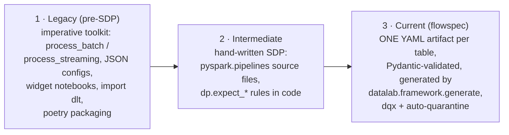

# Migration: legacy DLT-era framework → config-driven Lakeflow SDP

[← README](../README.md) · [Architecture](ARCHITECTURE.md) · [Framework](FRAMEWORK.md) · [CI/CD](CICD.md) · **Migration**

This repo has been through two restructures; this page maps old → current so
history stays navigable.

Today the framework is an external dependency (the `datalab-framework` repo);
complete reference domains live under `projects/` (this repo's example:
`projects/customer_sales/config/customer_sales/`). See the framework repo's
[FRAMEWORK.md](https://github.com/dediggibyte/datalab-framework/blob/v1.0.0/docs/FRAMEWORK.md)
and the naming contract in [NAMING.md](NAMING.md).

## Concept map (legacy → current)

| Legacy (removed) | Current replacement |
|---|---|
| `import dlt` notebooks | nothing hand-written: one YAML artifact per table; the 3-line `transformations/pipeline.py` is the only pipeline code |
| `process_batch(source, transform, target)` | `target.kind: materialized_view` artifact (+ a registered `@transform`) |
| `process_streaming(...)` + `foreachBatch` + checkpoints | `target.kind: streaming_table` artifact — the engine manages state; flow names are the checkpoint identity |
| `write_dataset(mode="upsert")` Delta MERGE | `target.cdc:` (AUTO CDC: keys, sequence_by, SCD1/2, deletes/truncates) — never MERGE |
| full-snapshot dimension reloads | `target.cdc_from_snapshot:` (SDP diffs successive snapshots, SCD1/2) |
| `SimpleDQ` / DQX checks JSON (`criticality: error/warn`) | dqx rules verbatim in the artifact (`columns[].quality` + `quality.checks`); `criticality` kept its meaning |
| DQX quarantine writer | auto-created `<table>_quarantine` with `_errors` evidence structs — error rules never silently drop rows |
| `config/**/*.json` per pipeline | `config/<catalog>/domain.yml` + `<schema>/<table>.yml` (Pydantic + JSON-schema validated) |
| notebook widgets (`get_widget_value`) | `pipeline_conf(spark, key)` (SDP) / `datalab.params.*` (job lanes) |
| notebook business logic + test mirror | pure functions in `src/<domain>_etl/transforms/` + pytest; integration = dev refresh |
| `pipelines/*.job.yml` (job clusters) | `resources/*.pipeline.yml` (serverless SDP) + `resources/*.job.yml` (pipeline_task) |
| `permissions/<env>/permission_variables.yml` | `pipeline_permissions` / `job_permissions` (+ group/level string vars) in `rbac.yml` (include'd by `databricks.yml`) |
| poetry + wheel build | uv (`uv.lock`); pipeline env installs the repo `--editable` — no wheel step |
| `dbconnect` CI integration tests | unit tests (local Spark) + `validate-configs` + `bundle validate`; integration via dev deploys |
| Azure SP secret-based CI auth | GitHub OIDC federation ([CICD.md](CICD.md)) |

## Intermediate → current (if you adopted the hand-written SDP phase)

| Hand-written SDP | Current replacement |
|---|---|
| `@dp.table` / `@dp.materialized_view` files per table | ONE `<layer>/<table>.yml` artifact; `make validate-configs` replaces "does it import" |
| `@dp.expect_all_or_drop(...)` / `@dp.expect_all(...)` | dqx rules in the artifact: `criticality: error` (drop + quarantine) / `warn` (flag); `dp.expect_*` is retired in this repo |
| `datalab.quality.violation_predicate` quarantine filter | dqx `get_invalid` + evidence structs (the deprecated `datalab.quality` shims are removed; git history has them) |
| hand-wired `dp.create_auto_cdc_flow` calls | `target.cdc:` in the artifact |
| `@dp.append_flow(once=True)` backfills by hand | `backfill:` entries in the artifact |
| rules dicts inside the framework | domain transforms moved to `src/<domain>_etl/transforms/`; the framework owns no domain code |

## Renames to remember

- **DLT → Lakeflow Spark Declarative Pipelines (SDP):** the `dlt` module is
  deprecated; `pyspark.pipelines` is the API (OSS in Apache Spark 4.1+).
  `@dlt.view` → `@dp.temporary_view`; `dlt.apply_changes` →
  `dp.create_auto_cdc_flow`; `dlt.apply_changes_from_snapshot` →
  `dp.create_auto_cdc_from_snapshot_flow`; `dlt.create_target_table` /
  `create_streaming_live_table` → `dp.create_streaming_table`.
- **Databricks Asset Bundles → Declarative Automation Bundles** (CLI
  v0.295.0): naming only; `databricks bundle` commands unchanged.
- **Repo layout (June 2026):** `src/sales_etl`, `src/jobs`, `notebooks/sales`,
  `config/sales`, the `resources/sales_*.yml` files and `sql/abac/` moved
  into a self-contained `projects/sales/` tree; `src/` then held only the
  framework. Adopter repos keep the root-level layout (`projects/README.md`
  maps one to the other).
- **Framework split (June 2026):** the reusable framework (`src/datalab`) was
  extracted into its own repo,
  [`dediggibyte/datalab-framework`](https://github.com/dediggibyte/datalab-framework);
  this repo now has no `src/` and consumes the framework as a git dependency
  (local/CI) + a UC-Volume wheel it builds + publishes on deploy
  ([ADOPTING.md](ADOPTING.md)).
- **UC-namespace naming (June 2026, [NAMING.md](NAMING.md)):** the example
  domain was renamed `sales` → `customer_sales` so folder paths mirror the UC
  namespace (the catalog is `customer_sales`): `projects/sales/` →
  `projects/customer_sales/`, `config/sales/` → `config/customer_sales/`,
  `src/sales_etl/` → `src/customer_sales_etl/` (transforms module
  `sales.py` → `customers.py`, registry keys `sales.*` → `customer_sales.*`),
  `src/jobs/sales/` → `src/jobs/customer_sales/`, `notebooks/sales/` →
  `notebooks/customer_sales/`, resources `sales_etl` / `sales_export` /
  `sales_quarantine_report` → `customer_sales_etl` / `customer_sales_export` /
  `customer_sales_quarantine_report`. The UC volumes (`landing.sales`,
  `exports.sales`) and the `sales_landing_path`/`sales_export_path` variables
  kept their names — they reference the unrenamed volumes. Renaming the
  resource keys recreates the deployed pipeline/jobs on next deploy (full
  refresh required).

## Carry-overs

The sales customer flow kept its semantics across all three eras:

- bronze→silver column selection + `to_date(signup_date)` → the artifact's
  `columns:` mapping (ANSI-safe `try_cast`) + the pure
  `customer_sales.normalize_email` transform.
- DQX `is_not_null(customer_id)` (error) and the email regex (warn) → the
  same dqx functions, now per-column `quality:` rules in
  `projects/customer_sales/config/customer_sales/silver/customers.yml`.
- MERGE on `customer_id` → AUTO CDC keyed on `customer_id`, sequenced by the
  `_ingest_ts` lineage column (`target.cdc`).
- Quarantine table `…customer_quarantine` → `silver.customers_quarantine`
  (auto-created, with dqx evidence).

If you need the old code, it lives in git history prior to these
restructures.
