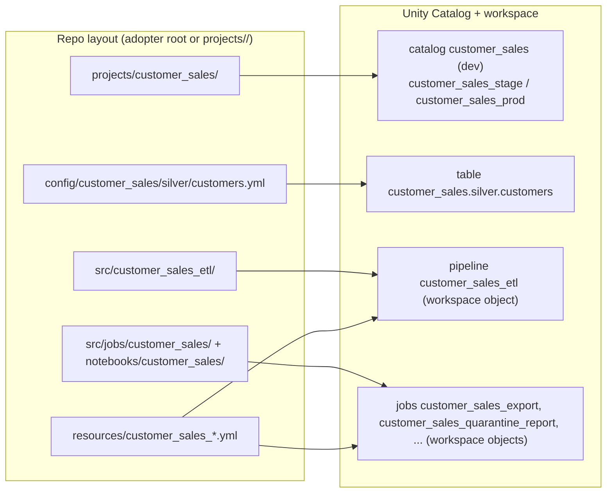

# NAMING.md — folder structure mirrors the Unity Catalog namespace

The repo layout is not arbitrary: **every domain folder path spells out where
its data and resources live in Unity Catalog**. A developer (or agent) reading
`config/customer_sales/silver/customers.yml` should
conclude, with no further context, that this artifact defines the table
`customer_sales.silver.customers`. This page is the contract; the
`customer_sales` reference domain in the datalab template repo demonstrates it.

<!-- template-only:naming-diagram start -->

<!-- template-only:naming-diagram end -->

## The rules

### 1. Domain folder == base catalog name

<!-- template-only:naming-domain-folder start -->
The domain folder (`projects/<catalog>/` here; the repo root in an adopter
repo) is named after the **base catalog** that holds the domain's medallion
schemas — `customer_sales` in the reference example.
<!-- template-only:naming-domain-folder end -->

Targets append an environment suffix to the SAME base name via the bundle
`catalog` variable (declared in `variables/medallion.yml`, valued per target in
`targets/<env>.yml`):

| Target | Catalog | Resolved from |
|---|---|---|
| dev | `customer_sales` | `targets.dev.variables.catalog` |
| stage | `customer_sales_stage` | `targets.stage.variables.catalog` |
| prod | `customer_sales_prod` | `targets.prod.variables.catalog` |

Folder names carry the **base** name only — never an environment suffix. No
file under the domain folder ever contains a literal catalog name; configs
declare conf KEYS (`datalab.catalog`) that the bundle resolves per target.
That stays true after this convention: the folder name is documentation of
intent, the variables remain the single resolution mechanism.

### 2. Config tree == catalog/schema/table

`config/<catalog>/<schema>/<table>.yml` — one artifact per target table, the
file name IS the table name:

```
config/customer_sales/                      → catalog customer_sales
  domain.yml                                  (domain settings, not a table)
  bronze/customers_raw.yml                  → customer_sales.bronze.customers_raw
  silver/customers.yml                      → customer_sales.silver.customers
  gold/customers_by_city.yml                → customer_sales.gold.customers_by_city
```

The schema folders are the medallion layers `bronze`/`silver`/`gold` — the
framework loader requires exactly these folder names, and the schema variables
they map to (`bronze_schema`/`silver_schema`/`gold_schema` in
`variables/medallion.yml`) default to the same names. Keep folder name == schema name;
if a deployment must use different schema names, the indirection lives in
`domain.yml` (`layers.<folder>.schema_conf`) and the target's schema
variables — never in the artifacts.

Derived datasets follow the table they belong to: the quarantine table of
`silver/customers.yml` is `customer_sales.silver.customers_quarantine`.

### 3. Domain package == `<catalog>_etl`

`src/<catalog>_etl/` (here `src/customer_sales_etl/`) holds the domain's
python: the 3-line pipeline entrypoint, pure `@transform` functions, custom
dqx checks. The directory name is the import name (it's packaged by the domain's
own `pyproject.toml` `[tool.hatch.build.targets.wheel]`), so imports and
`domain.yml` `imports:` read as `customer_sales_etl.transforms.customers`.

Registry keys are prefixed with the catalog name:
`@transform("customer_sales.normalize_email")` — making YAML references
(`transform: [function: customer_sales.normalize_email]`) self-describing.

### 4. Jobs and notebooks sit at catalog level

`src/jobs/<catalog>/` and `notebooks/<catalog>/` (here
`src/jobs/customer_sales/`, `notebooks/customer_sales/`). Jobs and pipelines
are **workspace objects, not schema objects** — they typically span schemas
(the export job reads gold and writes a volume), so they anchor to the
catalog, the closest UC namespace they serve. Which schemas a job touches is
declared by its `*.job.yml` parameters (`gold_schema`, `silver_schema`, ...),
not by its folder path.

### 5. Resource files and keys == deployed object names

`resources/<resource>.{pipeline,job}.yml`, where the file name equals the
bundle resource key equals the deployed object name, all prefixed with the
catalog:

<!-- template-only:naming-resource-table start -->
| File | Resource key / name | Kind |
|---|---|---|
| `customer_sales_etl.pipeline.yml` | `customer_sales_etl` | SDP pipeline |
| `customer_sales_etl.job.yml` | `customer_sales_etl_refresh` | scheduled `pipeline_task` |
| `customer_sales_export.job.yml` | `customer_sales_export` | python-file lane |
| `customer_sales_quarantine_report.job.yml` | `customer_sales_quarantine_report` | notebook lane |

The pipeline is `<catalog>_etl`; edge jobs are `<catalog>_<purpose>`.
<!-- template-only:naming-resource-table end -->

## Explicitly out of scope

<!-- template-only:naming-out-of-scope start -->
These keep their existing names; the `sales` in them refers to the **UC
volume named `sales`**, not the domain folder:

- UC volumes `landing.sales` and `exports.sales` — UC objects can't be renamed
  in place; they are out-of-band governance state (`scripts/bootstrap_uc.py`).
- The bundle variables `sales_landing_path` / `sales_export_path` and the
  GitHub variable `DATALAB_SALES_LANDING_PATH` — they name those volumes'
  paths. Rename them only if/when the volumes themselves are recreated under
  a new name.
- `domain.yml`'s file name and the `layers:`/`domain:` model fields — that is
  the framework contract (defined in the `datalab-framework` repo's models),
  shared by every adopter; this page only constrains the *values* (e.g.
  `domain: customer_sales`).
<!-- template-only:naming-out-of-scope end -->

## Renaming an existing domain (what it costs)

Folder renames are free for streaming state — generated flow names derive
from **dataset names**, not the domain or folder — but renaming the bundle
**resource keys** destroys and recreates the deployed pipeline/jobs on the
next `bundle deploy`. The new pipeline must adopt the UC tables, which
requires a **full refresh** (bronze re-ingests from landing, CDC targets
rebuild). Schedule it deliberately in stage/prod; dev just re-runs. The dqx
`run_id` evidence string also changes (it embeds the domain name) — cosmetic,
but quarantine dashboards filtering on it should be updated.

## Naming a new domain (rules recap)

This section is naming RULES only — the procedures live elsewhere: standing up
a **new adopter repo** is `docs/NEW_ADOPTER.md` (the scaffold applies these
rules for you); adding a domain to **this reference repo** is
`docs/ADOPTING.md` → "Adding a SECOND domain". Either way one rule carries
everywhere — the BASE catalog name:

1. Base catalog name, e.g. `finance` — lowercase, **no**
   `_dev`/`_stage`/`_prod` suffix (dev catalog `finance`; stage/prod
   `finance_stage`/`finance_prod` come from bundle variables per target).
2. Folders carry it: `config/finance/<schema>/<table>.yml`,
   `src/finance_etl/`, `src/jobs/finance/`, `notebooks/finance/`.
3. Resources carry it: pipeline `finance_etl`, jobs `finance_<purpose>`,
   registry keys `finance.*`.
